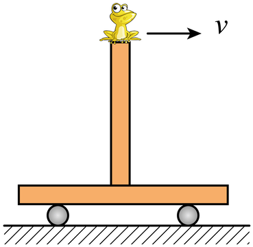

# Physics - 题目 2182

**ID**: 4b44454a6d0c4090b7b64cbbda16e8f6
**年级**: Grade 12
**难度**: Easy
**题型**: Calculation

## 题目
如图所示，一个质量为m的玩具蛙，蹲在质量为4m的小车的固定轻质细杆上，小车静置于光滑的水平桌面上，若车长为L，细杆高为h，且位于小车的中点。​​​​​​​‌玩具蛙以水平速度跳离细杆，并落在小车上。已知重力加速度为g，不计空气阻力。求：（1）玩具蛙水平位移大小的范围；（2）起跳过程，玩具蛙做功的最大值。

## 解答

1. （1）根据人船模型可得 $mx{{}_{蛙}}=4mx{{}_{车}}$ ， $x{{}_{蛙}}+x{{}_{车}}⩽\frac {L}{2}$
2. 所以 $0<x{{}_{蛙}}⩽\frac {2}{5}L$
3. （2）设起跳时玩具蛙和小车的最大速度分别为v_{1}和v_{2}，由于玩具蛙做平抛运动，则玩具蛙速度最大满足 $v{{}_{1}}t=\frac {2}{5}L$ ， $h=\frac {1}{2}gt{^{2}}$
4. 起跳过程中，玩具蛙和小车组成的系统水平方向动量守恒，则 $mv{{}_{1}}=4mv{{}_{2}}$
5. 玩具蛙做功的最大值为 $W=\frac {1}{2}mv{{}_{1}^{2}}+\frac {1}{2}\cdot 4mv{{}_{2}^{2}}=\frac {mgL{^{2}}}{20h}$

## 知识点

**中文**:
  - 动量和能量的综合应用

**English**:
  - Integration of Momentum and Energy

---
