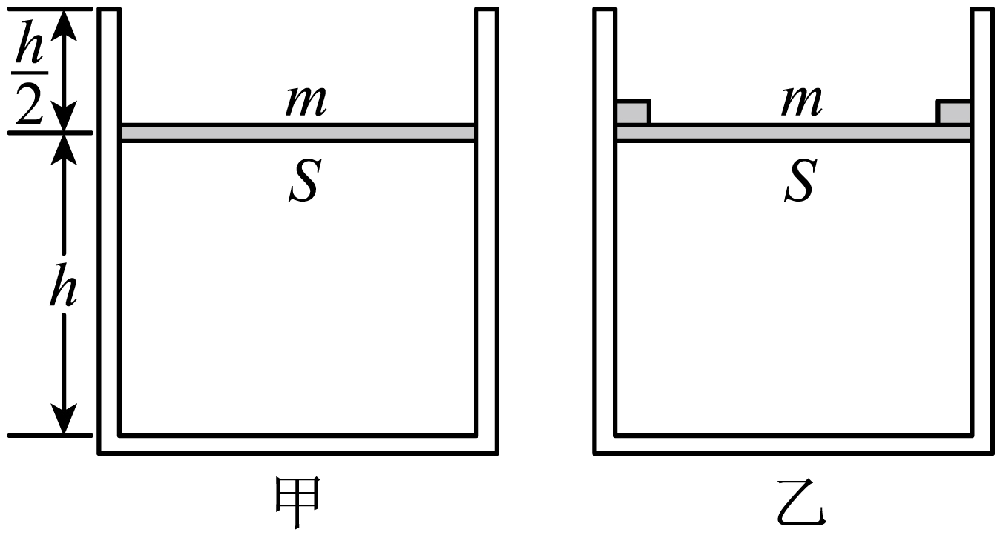

# Physics - 题目 544

**ID**: 4ed9e77fe1fd488393e8b3e26995fd5e
**年级**: Grade 12
**难度**: Easy
**题型**: Calculation

## 题目
如图甲，上端开口的导热汽缸放置在水平面上，质量为m、横截面积为S的活塞密封了一定质量的理想气体。​​​​​​​‌当环境温度为 $T{{}_{0}}$ 时，活塞静止的位置与气缸底部距离为h，离缸口的距离为 $\frac {h}{2}$ 。已知重力加速度为g，活塞厚度及活塞与汽缸壁之间的摩擦不计，大气压强为 $\frac {4mg}{S}$ 。求：（1）若缓慢升高环境温度，使活塞刚好能移到缸口，求升高后的环境温度T；（2）若先在缸内壁紧贴活塞上表面固定一卡环（与活塞接触但没有作用力），如图乙，再缓慢升高环境温度到T，则升温后卡环对活塞的压力多大。

## 解答

1. （1）缓慢升高环境温度，使活塞刚好能移到缸口的过程中，气体经历等压变化，设活塞刚好能移到缸口时气体的温度为T_{2}，根据盖—吕萨克定律得
2. $\frac {V{{}_{0}}}{T{{}_{0}}}=\frac {V{{}_{1}}}{T}$
3. 其中
4. $V{{}_{0}}=hS$
5. $V{{}_{1}}=\frac {3}{2}hS$
6. 联立解得
7. $T=\frac {3}{2}T{{}_{0}}$
8. （2）根据题意可知气体在升温过程中体积不变，根据查理定律可得
9. $\frac {p{{}_{1}}}{T{{}_{0}}}=\frac {p{{}_{2}}}{T}$
10. 其中
11. $p{{}_{1}}=\frac {mg}{S}+\frac {4mg}{S}=\frac {5mg}{S}$
12. $p{{}_{2}}=\frac {mg}{S}+\frac {4mg}{S}+\frac {F{{}_{{\rm{N}}}}}{S}=\frac {5mg+F{{}_{{\rm{N}}}}}{S}$
13. 联立解得升温后卡环对活塞的压力为
14. $F{{}_{{\rm{N}}}}=5mg\left ({\frac {T}{T{{}_{0}}}-1}\right )=\frac {5}{2}mg$

## 知识点

**中文**:
  - 气体的等压变化与盖—吕萨克定律
  - 气体的等容变化与查理定律

**English**:
  - Isobaric Change and Gay-Lussac's Law
  - Isochoric Change and Charles's Law

---
