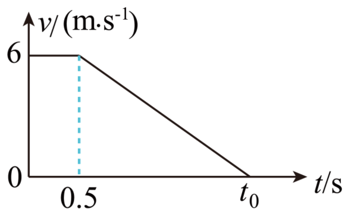

# Physics - 题目 2633

**ID**: 6df842e5b3464794b77fa05b0ad5122c
**年级**: Grade 12
**难度**: Easy
**题型**: Calculation

## 题目
《机动车驾驶证申领和使用规定》已经正式施行，司机闯红灯要扣6分，被称为“史上最严交规”。​​​​​​​‌某小轿车驾驶员看到绿灯开始闪时，经短暂时间思考即为驾驶员的反应时间，在反应时间内驾驶员来不及使用刹车后开始刹车，小轿车在红灯刚亮时恰停在停车线上，v-t图线如图所示．若绿灯开始闪烁时小轿车距停车线距离L=10.5m，求：(1)驾驶员反应时间内轿车的位移；(2)轿车的刹车时间；(3)轿车刹车的加速度。

## 解答

1. (1)由图可知，反应时间为 ${\rm{t}}{{}_{0}}=0.5{\rm{s}}$ ，速度为 $v{{}_{0}}=6{\rm{m}}/{\rm{s}}$ ，反应时间内通过的位移为 $x{{}_{1}}=v{{}_{0}}t{{}_{0}}=3{\rm{m}}$
2. (2)(3)刹车位移为 $x^{′}=L-x{{}_{1}}=7.5{\rm{m}}$ ，根据速度位移公式可知 $a=\frac {0-v{{}_{0}^{2}}}{2x^{′}}=-2.4{\rm{m}}/{\rm{s}}{^{2}}$ ，减速的时间 $t=\frac {0-v{{}_{0}}}{a}=2.5{\rm{s}}$ ，轿车的刹车时间 $t{{}_{总}}=t+t{{}_{0}}=3{\rm{s}}$

## 知识点

**中文**:
  - 刹车问题

**English**:
  - Braking Problems

---
