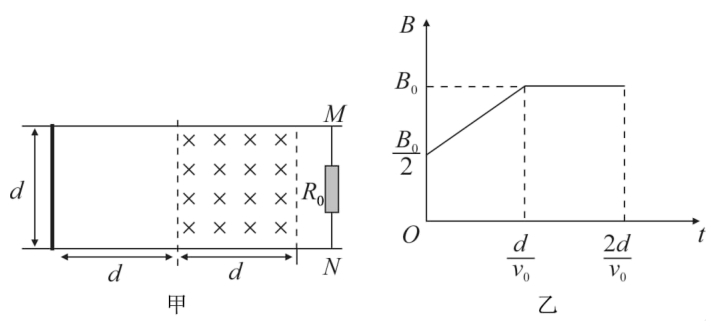

# Physics - 题目 1830

**ID**: cfc77832304f40d7824bf2de41a82861
**年级**: Grade 12
**难度**: Easy
**题型**: Calculation

## 题目
如图甲所示，两个平行金属导轨在同一水平面固定，间距为d，连接电阻 $R{{}_{0}}$ ，边长为d的正方形区域存在竖直向下的匀强磁场，磁感应强度B随时间t变化关系如图乙所示。​​​​​​​‌ $t=0$ 时，在距磁场左边界d处，一长为d的均匀导体棒在外力作用下，以恒定速度 $v{{}_{0}}$ 向右运动，直至通过磁场。导体棒阻值为 $R,R{{}_{0}}$ 的阻值为 $2R$ ，其他电阻不计，棒与导轨始终垂直且接触良好。求：（1） $0\sim \frac {d}{v{{}_{0}}}$ 时间内， $R{{}_{0}}$ 中的电流方向及感应电动势；（2） $\frac {d}{v{{}_{0}}}\sim \frac {2d}{v{{}_{0}}}$ 时间内，棒受到的安培力F的大小和方向。

## 解答

1. （1）由图乙可知在 $0\sim \frac {d}{v{{}_{0}}}$ 时间段内，磁场均匀增加，根据楞次定律可知 $R{{}_{0}}$ 中的电流方向为N到M，这段时间内的感应电动势根据法拉第电磁感应定律有 $E=\frac {ΔΦ}{Δt}=\frac {ΔBd{^{2}}}{Δt}=\frac {B{{}_{0}}dv{{}_{0}}}{2}$
2. （2）在 $\frac {d}{v{{}_{0}}}\sim \frac {2d}{v{{}_{0}}}$ 时间内根据左手定则可知棒受到的安培力方向水平向左，回路中的总电阻为 $R{{}_{总}}=2R+R=3R$
3. 根据 $E^{′}=B{{}_{0}}dv{{}_{0}}$ ， $F{{}_{安}}=B{{}_{0}}Id$ ， $I=\frac {E{^{\prime }}}{R{{}_{总}}}$
4. 可得 $F{{}_{安}}=\frac {B{{}_{0}^{2}}d{^{2}}v{{}_{0}}}{R{{}_{总}}}=\frac {B{{}_{0}^{2}}d{^{2}}v{{}_{0}}}{3R}$

## 知识点

**中文**:
  - 导体切割磁感线产生感应电动势（电流）的分析与计算
  - 电磁感应定律的应用

**English**:
  - Analysis and Calculation of Cutting Magnetic Field Lines
  - Applications of Faraday's Law

---
