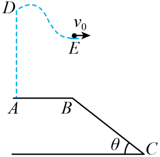

# Physics - 题目 453

**ID**: fdafea7e2c3f40949349d759613afbad
**年级**: Grade 12
**难度**: Easy
**题型**: Calculation

## 题目
如图，B是平地AB和斜坡BC的交接处，斜坡的倾角为37°，小明站在B处遥控无人机。​​​​​​​‌A处的无人机获得大小为其重力2倍、方向竖直向上的持续升力，由静止开始上升2s后到达D处。改变飞行模式，无人机飞到B点正上方17m处的E点时，无人机上的摄像机脱落，摄像机以v_{0}=2m/s的速度水平向右抛出，为避免坠毁，小明立即从B点沿斜坡向下做匀加速直线运动去接住摄像机．设斜坡足够长，取sin37°=0.6，cos37°=0.8，g取10m/s^{2}。求：(1)D点与A点的高度差h；(2)无人机从E处到达斜面上的时间。

## 解答

1. （1）由牛顿第二定律可得 $F-mg=ma{{}_{1}}$ ， $h=\frac {1}{2}a{{}_{1}}t{{}_{1}^{2}}$ ，解得 $h=20{\rm{m}}$
2. （2）设摄像机从脱落到被接住的时间为t_{2}，则 $x=v{{}_{0}}t{{}_{2}}$ ， $y=\frac {1}{2}gt{{}_{2}}{^{2}}$ ， ${\tan}θ=\frac {y-h}{x}$ ，解得 $t{{}_{2}}=2{\rm{s}}$

## 知识点

**中文**:
  - 求解平抛运动、类平抛运动问题

**English**:
  - Solving Horizontal and Quasi-Horizontal Projectile Problems

---
