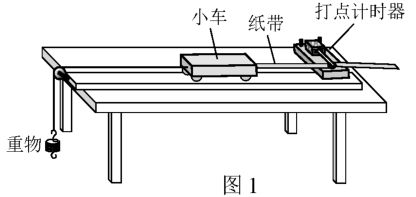

# Physics - 题目 2051

**ID**: 66fd08017b66449287bb83b1fdfc2510
**年级**: Grade 12
**难度**: Easy
**题型**: Experiment

## 题目
用图1所示的实验装置探究小车在恒定拉力下速度随时间变化的规律。​​​​​​​‌（1）除小车、重物、打点计时器（含纸带、复写纸）、导线、开关等器材外，在下面的仪器和器材中，必须使用的有（填选项代号）。

## 解答

1. （1）打点计时器工作需要电压合适的交流电源，不能使用直流电源；测量纸带上计数点间的距离需要刻度尺；打点计时器是计时仪器，则不需要秒表；该实验不需要测量小车或重物的质量，则不需要天平。
2. （2）探究小车在恒定拉力下速度随时间变化的规律只需要保证小车所受的合外力为恒力，则可以不用平衡摩擦力，则选项A是不必要的步骤，A错误；只需要保证小车所受的合外力为恒力，不需要用重物的重力近似替代为小车所受的合力，则不需要满足重物的质量远小于小车的质量，则选项B是不必要的步骤，B错误；调整定滑轮的高度使拉小车的细线与木板上表面平行，则细线的拉力为恒力，从而保证小车所受的合外力为恒力，则选项C是必要的步骤，C正确；调整打点计时器的位置使纸带可以顺畅地穿过限位孔，避免产生额外的阻力，则选项D是必要的步骤，D正确。
3. （3）从图中数据可知，在打C点时小车的瞬时速度为 $v{{}_{C}}=\frac {x{{}_{BD}}}{2t}=\frac {(14.30-5.50)\times 10{^{-2}}}{0.2}{\rm{m}}{\rm{/}}{\rm{s}}=0.44{\rm{m}}{\rm{/}}{\rm{s}}$ 。
4. （4） $v-t$ 图像的斜率表示加速度，图像是一条倾斜的直线，则斜率不变，即加速度不变，可知小车做匀变速直线运动。

## 知识点

**中文**:
  - 实验：探究小车速度随时间变化的规律

**English**:
  - Experiment: Investigating Cart Velocity vs Time

---
