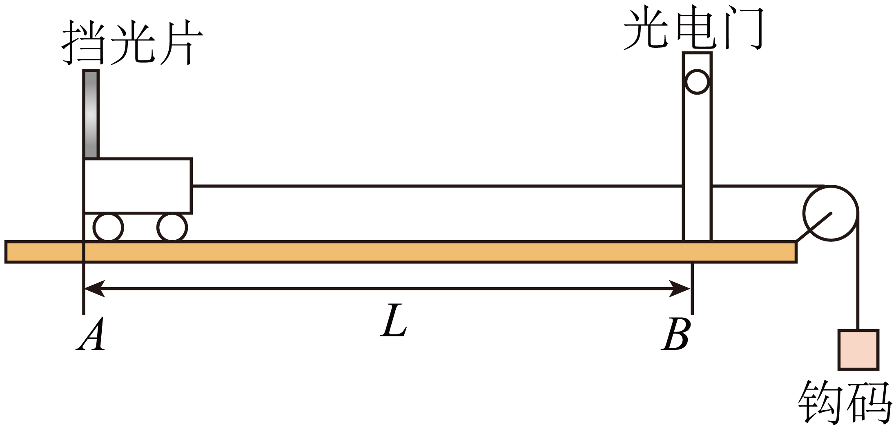

# Physics - 题目 573

**ID**: 6b8b86d54ba647ca859facb8a77a3ea6
**年级**: Grade 12
**难度**: Easy
**题型**: Experiment

## 题目
在“用DIS研究加速度和力的关系”实验中：某同学采用光电门测量加速度，实验装置如图。​​​​​​​‌将小车放置在轨道上，使挡光片的左端与小车的左端A点对齐，光电门放在B处，测出A到B的距离L和挡光片的宽度d、由静止开始释放小车，光电门自动测出小车上挡光片通过光电门的时间Δt。(1)根据题中已知物理量，小车的加速度a=（用题中字母表示）；(2)在上述实验中，下列操作步骤中必须做到的是

## 解答

1. （1）小车从A到B有 $v{^{2}}=2aL$ ，其中v为B点速度大小，其值为 $v=\frac {d}{Δt}$ ，联立解得 $a=\frac {d{^{2}}}{2L{\left({Δt}\right)^{2}}}$
2. （2）A．本实验采用控制变量法，研究加速度和力的关系时只要保证小车质量不变就行，不需要测量小车质量，A错误；
3. B．设绳子上的拉力大小为T，小车质量为M，钩码质量为m，在平衡摩擦力的前提下，对小车和钩码有 $T=Ma$ ， $mg-T=ma$ ，解得 $T=\frac {M}{M+m}mg$ ，本实验认为钩码重力大小为绳子拉小车拉力的大小，所以钩码的质量应该远小于小车质量，B正确；
4. C．本实验采用控制变量法，研究加速度和力的关系时要保证小车质量不变，C错误；
5. D．轨道光滑的话不需要平衡摩擦力，轨道保持水平，轨道不光滑的话，要使轨道倾斜来平衡摩擦力，D错误。选B。
6. （3）由图知，当钩码质量大于某值时，小车才有加速度，说明小车与轨道间存在摩擦力，当绳子拉力大于摩擦力时小车才动起来。

## 知识点

**中文**:
  - 实验：探究加速度与力、质量的关系

**English**:
  - Experiment: Acceleration vs Force and Mass (Newton's 2nd Law)

---
