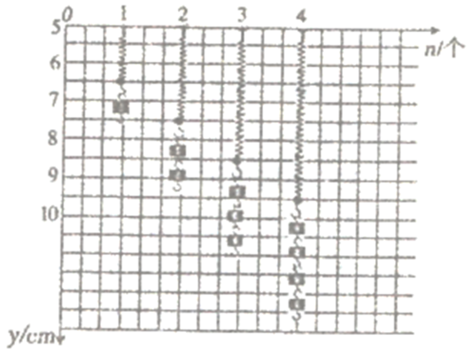

# Physics - 题目 783

**ID**: 890ce1e808144e0e99fc4f11252df92c
**年级**: Grade 12
**难度**: Easy
**题型**: Experiment

## 题目
某同学探究弹簧弹力与弹簧伸长量的关系，在竖直木板上固定一张坐标纸，建立如图所示坐标系，横轴代表所挂钩码个数。​​​​​​​‌实验时将弹簧挂一个钩码置于横轴为1的位置，待弹簧稳定后用笔在坐标纸上描出弹簧末端的位置；再将弹簧挂两个相同的钩码置于横轴坐标为2的位置，再次用笔在坐标纸上描出弹簧末端的位置；继续增加钩码，依次将弹簧置于3、4位置，再次描出两个点，如图中黑点所示。已知所挂钩码均相同，质量，重力加速度g取，弹簧劲度系数为k。回答以下问题：（1）弹簧劲度系数为；（2）弹簧原长为cm；（3）图中黑点连线的斜率（用k、m、g表示）。

## 解答

1. （1）[1]由图可知，挂1个钩码时，弹簧长度为；挂4个钩码时，弹簧长度为；根据胡克定律可得，弹簧劲度系数为
2. 
3. （2）[2]设弹簧的原长为，挂1个钩码时，弹簧长度为；根据受力平衡可得
4. 
5. 解得
6. 
7. （3）[3]图中黑点连线的斜率
8. 
9. 根据胡克定律可得
10. 
11. 解得
12. 

## 知识点

**中文**:
  - 弹力的大小与胡克定律

**English**:
  - Magnitude of Elastic Force and Hooke's Law

---
