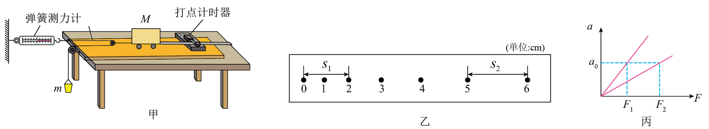

# Physics - 题目 1266

**ID**: 8f7a62bf75cb4724b9d1247cf2334c00
**年级**: Grade 12
**难度**: Easy
**题型**: Experiment

## 题目
为了探究质量一定时加速度与力的关系，某同学设计了如图甲所示的实验装置，其中带滑轮的小车的质量为M，沙和沙桶的质量为 $m$ 。​​​​​​​‌(1)实验时，一定要进行的操作是（      ）

## 解答

1. （1）ABC．本实验中绳子的拉力大小就是弹簧测力计的读数，所以不需要用天平测沙和沙桶的质量，也无需满足m远小于 $M$ ，但需要将带滑轮的长木板右端垫高，以平衡摩擦力；故AC错误，B正确；
2. D．实验时需要将小车靠近打点计时器，先接通电源，再释放小车，打出一条纸带，同时记录弹簧测力计的示数，故D正确。
3. 故选BD。
4. （2）[1]设0~1之间的距离为 $x{{}_{1}}{\rm ，1}$ ~2之间的距离为 $x{{}_{2}}$ ，利用逐差法可得
5. $s{{}_{2}}-x{{}_{1}}=5aT{^{2}}$
6. $s{{}_{2}}-x{{}_{2}}=4aT{^{2}}$
7. $x{{}_{1}}+x{{}_{2}}=s{{}_{1}}$
8. $T=\frac {1}{f}$
9. 联立可得，小车加速度大小为
10. $a=\frac {\left ({2s{{}_{2}}-s{{}_{1}}}\right )f{^{2}}}{9}$
11. [2]实际频率高于f，计算频率偏小，计算的加速度a偏小，所以计算结果与实际值比较则偏小。
12. （3）依题意结合图丙，根据牛顿第二定律
13. $2F=Ma$
14. 可得小车的质量为
15. $M=\frac {2F{{}_{1}}}{a{{}_{0}}}$
16. 放上物体后，小车及物体的质量为
17. $M+m{{}_{0}}=\frac {2F{{}_{2}}}{a{{}_{0}}}$
18. 联立两式可得
19. $\frac {2F{{}_{2}}}{a{{}_{0}}}=\frac {2F{{}_{1}}}{a{{}_{0}}}+m{{}_{0}}$
20. 即
21. $m{{}_{0}}=\frac {2F{{}_{2}}}{a{{}_{0}}}-\frac {2F{{}_{1}}}{a{{}_{0}}}=\frac {2F{{}_{2}}-2F{{}_{1}}}{a{{}_{0}}}$
22. 所以物体的质量
23. $m{{}_{0}}=\frac {2\left ({F{{}_{2}}-F{{}_{1}}}\right )}{a{{}_{0}}}$

## 知识点

**中文**:
  - 实验：探究加速度与力、质量的关系

**English**:
  - Experiment: Acceleration vs Force and Mass (Newton's 2nd Law)

---
