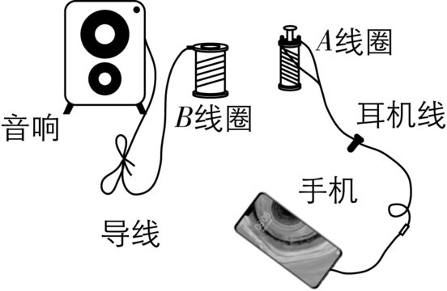

# Physics - 题目 83

**ID**: 133a6751b256437fba1fd84af77adb81
**年级**: Grade 12
**难度**: Easy
**题型**: Multiple-choice

## 题目
某同学通过学习电磁感应的相关知识,利用实验室里的线圈自制了一个放大版的手机扬声器,装置如图所示。​​​​​​​‌两个匝数不同的线圈A、B之间没有导线相连,线圈A与手机的音频输出端连接,线圈B与音响连接。为检验该装置的工作情况及其播放效果,现将线圈A插入线圈B中,则下列说法正确的是    	（      ）

## 解答

1. 选项
2. 分析
3. 正误
4. A
5. 该装置的原理是互感,A、B线圈不需要用导线连通
6. ×
7. B
8. 线圈B中产生变化的电流使音响发出不同的声音
9. √
10. C
11. A、B两个线圈的匝数不同,类比变压器可知电流与匝数有关,将A、B线圈互换,感应电流变化,音响的播放效果发生变化
12. ×
13. D
14. 在A线圈中插入铁芯,增强了电磁感应现象,使感应电流增大,音响的播放效果会更好
15. ×

## 知识点

**中文**:
  - 电磁感应现象中的能量转化及应用

**English**:
  - Energy Conversion in EM Induction

---
