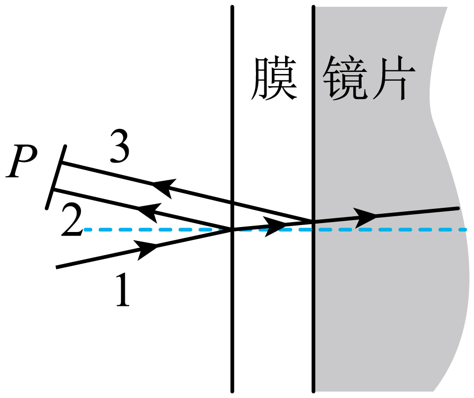

# Physics - 题目 2711

**ID**: 1977e2c7a9fd4293bf6b39fd0dc346c6
**年级**: Grade 12
**难度**: Easy
**题型**: Multiple-choice

## 题目
增透膜被广泛应用于各种光学透镜。​​​​​​​‌如图，入射光1以接近法线方向入射镀膜镜片，反射光2和3在P处相干减弱，则2和3在P处的光振动图像可能为（      ）

## 解答

1. 由图可知2和3两束光传播方向相反，在P处相干减弱，所以两束光在P处振动方向相反，根据同侧法可知C正确。选C。

## 知识点

**中文**:
  - 波的图像及其应用

**English**:
  - Wave Graphs and Applications

---
