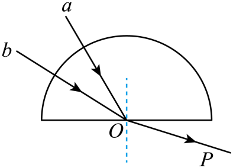

# Physics - 题目 1006

**ID**: 1dc26d5794874daeb2f4c5cc96cb65df
**年级**: Grade 12
**难度**: Easy
**题型**: Multiple-choice

## 题目
如图所示，a、b两束单色光分别沿半径方向射向圆柱形的玻璃砖，出射光线均沿 $OP$ 方向。​​​​​​​‌下列说法正确的是（      ）

## 解答

1. 在真空中传播时两种光的波速相同，A错误；由图可知a光折射的偏折大，由折射定律可知，a光折射率较大，则a光频率更高，在真空中传播时波长更短，B错误；由于b光波长较长，对于同一个很窄的单缝，b光衍射现象更明显，C正确；由 $\sin C=\frac {1}{n}$ 可知，a光临界角更小，位于水下同一深度时，a光在水面形成的光斑面积更小，D错误。

## 知识点

**中文**:
  - 全反射与折射的综合应用

**English**:
  - Comprehensive Application of Total Reflection and Refraction

---
