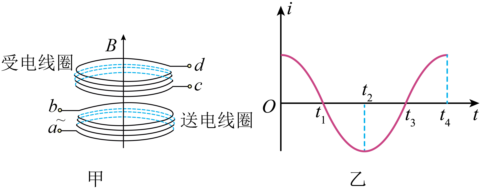

# Physics - 题目 389

**ID**: 26c9cb383d104a7da29e2db290552e3c
**年级**: Grade 12
**难度**: Easy
**题型**: Multiple-choice

## 题目
如图甲所示为某电动牙刷的无线充电示意图，送电线圈以由a到b为电流的正方向，当送电线圈通过如图乙所示的电流时，在 $0\sim t{{}_{1}}$ 时间内（      ）​​​​​​​‌

## 解答

1. 在 $0\sim t{{}_{1}}$ 时间内，送电线圈电流减小，但是电流的变化率变大，穿过受电线圈的磁通量变化率变大，则受电线圈中产生的感应电流变大，根据楞次定律可知，受电线圈中电流方向由d到c。选A。

## 知识点

**中文**:
  - 楞次定律及其应用

**English**:
  - Lenz's Law and Applications

---
