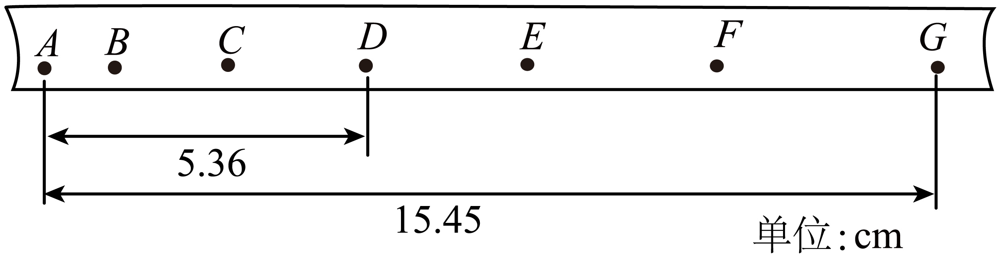

# Physics - 题目 342

**ID**: 2a6566f055a54f7b846c662853364d04
**年级**: Grade 12
**难度**: Easy
**题型**: 非选择题：本题共5小题，共54分。

## 题目
某同学用打点计时器研究匀变速直线运动，获得如图所示的纸带，相邻两个计数点间有四个计时点未画出。​​​​​​​‌已知打点计时器的打点频率为 $50{\rm {\rm Hz}}$ 。（1）由图中数据可得纸带的加速度大小为${\rm }{\rm m}/{\rm{s}}{^{2}}{\rm }$ （结果保留两位有效数字）。（2）若打点前纸带的G点一端靠近打点计时器，则纸带做匀（填“加”或“减”）速运动。（3）若实际上电源的频率为 $48{\rm {\rm Hz}}$ 而没有被发觉，则实验测得纸带的加速度值较真实值（填“偏大”“偏小”或“一样”）。

## 解答

1. （1）相邻两个计数点间有四个计时点未画出，则相邻计数点的时间间隔为 $T=5\times 0.02{\rm{s}}=0.1{\rm{s}}$
2. 根据逐差法可得加速度大小为 $a=\frac {x{{}_{DG}}-x{{}_{AD}}}{9T{^{2}}}=\frac {(15.45-5.36-5.36)\times 10{^{-2}}}{9\times 0.1{^{2}}}{\rm{m}}/{\rm{s}}{^{2}}\approx 0.53{\rm{m}}/{\rm{s}}{^{2}}$
3. （2）若打点前纸带的G点一端靠近打点计时器，由图可知，相同时间内通过的位移逐渐减小，所以纸带做匀减速运动。
4. （3）若实际上电源的频率为 $48{\rm {\rm Hz}}$ 而没有被发觉，实际打点周期大于 $0.02{\rm{s}}$ ，则代入计算的时间间隔偏小，实验测得纸带的加速度值较真实值偏大。

## 知识点

**中文**:
  - 实验：探究小车速度随时间变化的规律

**English**:
  - Experiment: Investigating Cart Velocity vs Time

---
