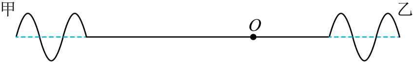

# Physics - 题目 1936

**ID**: 3919ba050e534de7ad6f02864e2afc69
**年级**: Grade 12
**难度**: Easy
**题型**: Multiple-choice

## 题目
某物理兴趣小组的两位同学对波的干涉特别感兴趣，利用课余时间进行了如下实验探究。​​​​​​​‌两位同学以相同频率分别在两端甩动水平细绳，形成两列简谐横波甲、乙，已知甲、乙两波源相距8m，甲、乙两波的波速均为 $0.5{\rm{m}}/{\rm{s}}$ ，完成一次全振动的时间均为2s，距离乙波源3m的O点处串有一颗红色珠子。某一时刻的波形图如图所示，从该时刻开始计时。则下列说法正确的是（      ）

## 解答

1. A．两列波的波长均为 $λ=vT=0.5\times 2{\rm m}=1.0{\rm m}$ ，A错误；
2. B．红色珠子上下振动，不会左右传播，B错误；
3. C．该时刻细绳两端的振动情况都是向下振动，C错误；
4. D．O点到两波源的距离差为 $\Delta x=\left ({8{\rm m}-3{\rm m}}\right )-3{\rm m}=2{\rm m}=2λ$O点到两波源的距离差为波长的整数倍，当两列波在O点相遇时，该点的振动加强，D正确。选D。

## 知识点

**中文**:
  - 波的干涉的应用

**English**:
  - Applications of Wave Interference

---
