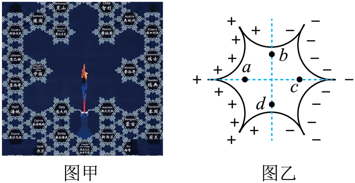

# Physics - 题目 1631

**ID**: 3976cb90e48b4431a46b56820a410ef5
**年级**: Grade 12
**难度**: Easy
**题型**: Multiple-choice

## 题目
2022年北京冬奥会开幕式上，由一朵朵代表各个参赛国家的“小雪花”组成一朵“大雪花”后，裹运圣火在其中央点燃，如图甲，让全世界惊叹。​​​​​​​‌某同学发现每朵“小雪花”的基本形状如图乙所示，并利用绝缘弧形细条摆成模型，若其左右分别均匀分布着等量异种电荷。a、b、c、d四点均位于对称轴上，且它们与中心点的距离均相等。则（      ）

## 解答

1. A．根据对称性可知，ab两点间与bc两点间电场强度的平均值相同，则ab两点电势差 $U{{}_{ab}}$ 等于bc两点电势差 $U{{}_{bc}}$ ，故A错误；
2. B．由图可知，电场方向由a到c，由于沿着电场线，电势降低，因此a点电势比c点电势高，故B错误；
3. C．根据对称性可知，b、d两点的场强大小相等，方向相同，故C正确；
4. D．根据对称性可知，b、d两点所在直线为等势线，则b、d两点的电势均为零，则正的试探电荷从b点到d点电场力做功为零，电势能不变，故D错误。
5. 故选C。

## 知识点

**中文**:
  - 电势能与静电力做功

**English**:
  - Electric Potential Energy and Work Done by Electrostatic Force

---
