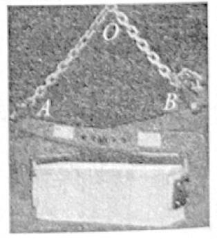

# Physics - 题目 1075

**ID**: 42ed84c5f0164299800f4f1ddd5dc26b
**年级**: Grade 12
**难度**: Easy
**题型**: Multiple-choice

## 题目
如图用夹石器夹住石块，借助吊车的吊钩钩住铁链 $AB$ 的中点 $O$ 即可将石块吊起并运走。​​​​​​​‌若夹石器夹住质量为 $m$ 的石块处于静止状态，吊钩位于铁链的中点 $O$ ，夹石器的质量也为 $m$ 。铁链 $AB$ 的质量可忽略不计，重力加速度为 $g$ ,下列说法正确的是（      ）

## 解答

1. 将石块和夹石器整体作为研究对象，受力分析如图所示，根据对称性可知，铁链 $OA$ 、 $OB$ 的拉力大小均为 $F$ ，则有 $2F\cos \theta =2mg$ ， $\theta $  为铁链与竖直方向的夹角，由于 $\theta $  未知，故 $F$ 不可求， $\mathrm{A}$错误；石块受到重力、两侧夹石器的压力和摩擦力共五个力的作用， $\mathrm{B}$错误；吊钩对铁链的作用力大小与石块和夹石器整体的重力大小相等，为 $2mg$ ，根据牛顿第三定律可知，铁链对吊钩的作用力等于 $2mg$ ， $\mathrm{C}$错误；若仅缩短铁链长度， $\theta $  增大， $\cos \theta $  减小，铁链 $OA$ 、 $OB$ 的拉力均增大， $\mathrm{D}$正确。
2. 

## 知识点

**中文**:
  - 解析法在解动态平衡问题中的应用

**English**:
  - Analytical Method for Dynamic Equilibrium

---
