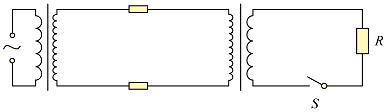

# Physics - 题目 2158

**ID**: 44c91f9d81af41dfaf03cb4963f4fed7
**年级**: Grade 12
**难度**: Easy
**题型**: Multiple-choice

## 题目
输电能耗演示电路如图所示。​​​​​​​‌左侧理想变压器原、副线圈匝数比为1:4，输入电压有效值为9V的正弦式交流电。连接两理想变压器的导线总电阻为4Ω，负载R的阻值为8Ω。右侧理想变压器原、副线圈匝数比为2:1，R消耗的功率为P。以下计算结果正确的是（      ）

## 解答

1. 根据题意可知，升压变压器原线圈两端的电压为 $U{{}_{1}}=9{\rm{V}}$ ，根据原副线圈电压与匝数的关系 $\frac {U{{}_{1}}}{U{{}_{2}}}=\frac {n{{}_{1}}}{n{{}_{2}}}$ ，所以 $U{{}_{2}}=36{\rm{V}}$ ，在输电回路中，有 $U{{}_{2}}=U{{}_{3}}+I{{}_{2}}r$ ， $\frac {U{{}_{3}}}{U{{}_{4}}}=\frac {n{{}_{3}}}{n{{}_{4}}}=\frac {2}{1}$ ， $U{{}_{4}}=I{{}_{4}}R$ ， $\frac {I{{}_{2}}}{I{{}_{4}}}=\frac {n{{}_{4}}}{n{{}_{3}}}$ ，联立可得 $I{{}_{4}}=2{\rm{A}}$ ，所以 $P=I{{}_{4}^{2}}R=32{\rm{W}}$ ，选B。

## 知识点

**中文**:
  - 理想变压器原、副线圈两端的电压、功率、电流关系及其应用

**English**:
  - Voltage, Power, Current Relations in Ideal Transformers

---
