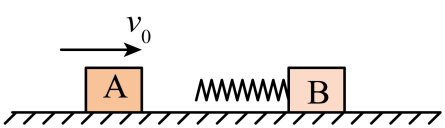

# Physics - 题目 1718

**ID**: 4df66b85bd2a4af0b390728306ab0fa4
**年级**: Grade 12
**难度**: Easy
**题型**: Multiple-choice

## 题目
如图所示，光滑水平面上有质量均为m的物块A和B，B的左侧固定一水平轻质弹簧，B原来静止。​​​​​​​‌若A以速度 $v{{}_{0}}$ 水平向右运动，与弹簧发生相互作用，弹簧始终处在弹性限度内，弹簧弹性势能的最大值为（      ）

## 解答

1. 当两个滑块速度相等时弹簧压缩量最大，弹性势能最大，滑块A、B系统动量守恒，根据守恒定律，有 $mv{{}_{0}}=2mv{{}_{1}}$ ，解得 $v{{}_{1}}=\frac {1}{2}v{{}_{0}}$ ，系统减少的动能等于弹簧增加的弹性势能，弹簧获得的最大弹性势能 $E{{}_{{\rm{p}}}}$ 为 $E{{}_{{\rm{p}}}}=\frac {1}{2}mv{{}_{0}^{2}}-\frac {1}{2}\times 2mv{{}_{1}^{2}}$ ，解得 $E{{}_{{\rm{p}}}}=\frac {1}{4}mv{{}_{0}^{2}}$ ，选C。

## 知识点

**中文**:
  - 动量和能量的综合应用

**English**:
  - Integration of Momentum and Energy

---
