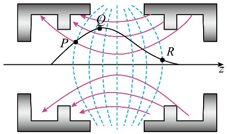

# Physics - 题目 802

**ID**: 4f7f88b86a464dce9b9845a438d64417
**年级**: Grade 12
**难度**: Easy
**题型**: Multiple-choice

## 题目
静电透镜被广泛应用于电子器件中，如图所示，阴极射线示波管的聚焦电场由四个电极构成，其中实线为电场线，虚线为等差等势线，z轴为该电场的中心轴线，一电子从其左侧进入聚焦电场， $P、Q、R$ 为其轨迹上的三点。​​​​​​​‌电子从P点运动到R点的过程中，则（      ）

## 解答

1. A．沿电场线电势逐渐降低，可知P点的电势低于R点，选项A错误；
2. B．因Q点电场线较R点密集，可知Q点的电场强度大于R点的电场强度，选项B错误；
3. C．因R点电势高于Q点，则电子在R点的电势能小于在Q点的电势能，因电子的电势能和动能之和守恒，可知电子在Q点的动能小于在R点的动能，选项C正确；
4. D．从P至R电势一直升高，则电子的运动过程中，电子的电势能一直减小，选项D错误。选C。

## 知识点

**中文**:
  - 电势能与静电力做功

**English**:
  - Electric Potential Energy and Work Done by Electrostatic Force

---
