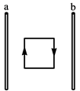

# Physics - 题目 2238

**ID**: 5129e8d1abbd498681c5caf49c01aa33
**年级**: Grade 12
**难度**: Easy
**题型**: Multiple-choice

## 题目
如图，光滑水平桌面上，a和b是两条固定的平行长直导线，通以相等电流强度的恒定电流。​​​​​​​‌通有顺时针方向电流的矩形线框位于两条导线的正中央，在a、b产生的磁场作用下处于静止状态，且有向外扩张的形变趋势，则a、b导线中的电流方向（      ）

## 解答

1. 因同向电流相吸，异向电流相斥，则由于在a、b产生的磁场作用下处于静止状态，且有向外扩张的形变趋势，可知a导线与线框的左边电流同向，b导线与线框的右边电流同向，即a向上，b向下。
2. 故选C。

## 知识点

**中文**:
  - 安培力的方向（左手定则）

**English**:
  - Direction of Ampere Force (Left-Hand Rule)

---
