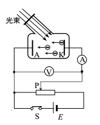

# Physics - 题目 1199

**ID**: 5d33ff53de2b46febea1ff4125e1bc94
**年级**: Grade 12
**难度**: Easy
**题型**: Multiple-choice

## 题目
如图所示是研究光电效应的电路，阴极K和阳极A是密封在真空玻璃管中的两个电极，阴极K在受到光照时能够发射光电子。​​​​​​​‌阳极A吸收阴极K发出的光电子，在电路中形成光电流。如果用单色光a照射阴极K，灵敏电流表的指针会发生偏转；用单色光b照射阴极K时，灵敏电流表的指针不发生偏转。下列说法正确的是（      ）

## 解答

1. A．单色光a照射阴极K，灵敏电流表的指针会发生偏转，说明发生了光电效应；单色光b照射阴极K时，灵敏电流表的指针不发生偏转，说明没有发生光电效应；可得
2. $υ{{}_{a}}>υ{{}_{极限}}>υ{{}_{b}}$
3. A错误；
4. B．由于b光的频率小于极限频率，b光照射不会发生光电效应，即电流表指针依然不会发生偏转，B正确；
5. C．阴极K逸出电子的最大初动能满足
6. $E{{}_{k}}=hυ-W$
7. 因为a光的频率不变，即阴极K逸出电子的最大初动能 $E{{}_{k}}$ 不变，C错误；
8. D．电流表的读数为零时，即电源电压满足
9. $eU=E{{}_{k}}=hυ-W$
10. 若
11. $U{{}_{1}}＜\frac {hυ-W}{e}$
12. 时，则电流表的读数不为零，D错误。
13. 故选B。

## 知识点

**中文**:
  - 光电效应规律的综合应用

**English**:
  - Comprehensive Application of Photoelectric Effect

---
