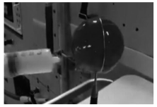

# Physics - 题目 1254

**ID**: 5f484570e57248c691f987591f87eed0
**年级**: Grade 12
**难度**: Easy
**题型**: Multiple-choice

## 题目
2022年11月21日中国空间站第三次太空授课中演示了紫色水球从“活跃”到“懒惰”的过程。​​​​​​​‌如图所示，用注射器向水球喷气，水球发生振动。向水球射入一枚质量10g的钢球，钢球留在水球中，再用注射器以相同方式向水球喷气，水球振动幅度减小。则（      ）

## 解答

1. A．根据动量定理，力的冲量相同的情况下，质量小的物体获得的速度大，振幅也大，A错误；
2. BC．水球振动中不破裂，钢球射入水球而未穿出，是水的表面张力起了作用，B错误，C正确。
3. D．太空中处于失重状态，浮力为0，D错误；选C。

## 知识点

**中文**:
  - 液体的表面张力
  - 航天器中的失重现象

**English**:
  - Surface Tension of Liquids
  - Weightlessness in Spacecraft

---
