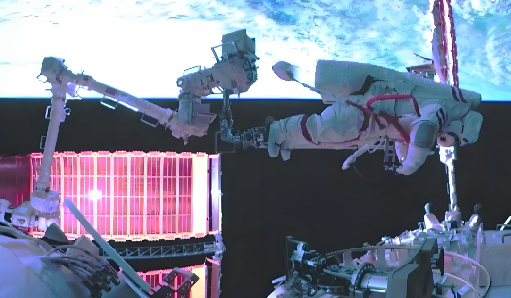

# Physics - 题目 801

**ID**: 699c1dd721674809b8c817caebb328d6
**年级**: Grade 12
**难度**: Easy
**题型**: Multiple-choice

## 题目
北京时间2024年12月17日21时57分，神舟十九号乘组航天员经过9小时6分钟的出舱活动，完成太空出舱任务，超越了美国NASA在2001年创下的8小时56分钟的纪录。​​​​​​​‌若中国空间站做圆周运动的轨道半径为r，地球半径为R，地球表面的重力加速度为g，则在地球上看，站在机械臂上的航天员的加速度是（      ）

## 解答

1. 在地球表面有 $\frac {GMm}{R{^{2}}}=mg$ ，在中国空间站的轨道处，有 $\frac {GMm{^{\prime }}}{r{^{2}}}=m{^{\prime }}a$ ，联立可得站在机械臂上的航天员的加速度为 $a=\frac {R{^{2}}g}{r{^{2}}}$ 。

## 知识点

**中文**:
  - 万有引力定律问题的分析与计算

**English**:
  - Analysis and Calculation of Gravitation Problems

---
