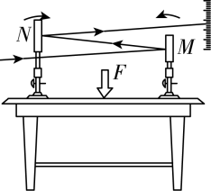

# Physics - 题目 1125

**ID**: 74923bdb94ef41829bf45eb52b315d95
**年级**: Grade 12
**难度**: Easy
**题型**: Multiple-choice

## 题目
物理思想和方法是研究物理问题的重要手段，如图所示，为了观察桌面的微小形变，在一张大桌子上放两个平面镜M和N，让一束光依次被这两面镜子反射，最后射到墙上，形成一个光点。​​​​​​​‌当用力F压桌面时，光点的位置会发生明显变化，通过光点位置的变化反映桌面的形变。这个实验中主要用到的思想方法与下列哪个实验用到的思想方法相同

## 解答

1. 该实验利用光的反射把微小形变进行放大，采用了微小量放大法，卡文迪什扭称实验也用到了微小量放大法，A正确；伽利略斜面实验探究物体下落规律用到了数学推理法，探究圆周运动的向心力大小的表达式用到了控制变量法，探究力的合成规律用到了等效替代法，B、C、D错误。

## 知识点

**中文**:
  - 弹性形变和弹力

**English**:
  - Elastic Deformation and Elastic Force

---
