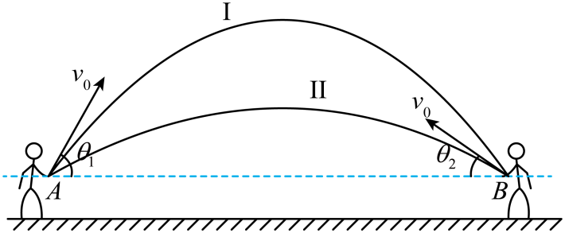

# Physics - 题目 1457

**ID**: 79b25206def54b2492cd653aa228d5b2
**年级**: Grade 12
**难度**: Easy
**题型**: Multiple-choice

## 题目
如图所示，A、B两位同学从同一高度分别抛出沙包1和2，两沙包抛出的初速度大小均为 $v{{}_{0}}$ ，方向与水平方向的夹角分别为 $θ{{}_{1}}$ 、 $θ{{}_{2}}$ ，且 $θ{{}_{1}}>θ{{}_{2}}$ ，两沙包抛出后在空中的运动轨迹分别如图中Ⅰ和Ⅱ所示。​​​​​​​‌两位同学均能在各自的抛出点接住对方抛来的沙包，不计空气阻力，下列说法正确的是（      ）

## 解答

1. A．沙包做斜抛运动，水平方向做匀速直线运动，竖直方向做竖直上抛运动，
2. $t=\frac {2v{{}_{0}}{\sin}θ{{}_{2}}}{g}$ ，水平方向有 $x=v{{}_{0}}{\cos}θ{{}_{2}}t=\frac {v{{}_{0}^{2}}{\sin}2θ{{}_{2}}}{g}$ ，A正确；
3. B．沙包1和2在空中运动时间之比为 $\frac {t{{}_{1}}}{t{{}_{2}}}=\frac {{\sin}θ{{}_{1}}}{{\sin}θ{{}_{2}}}$ ，B错误；
4. C．沙包1和2运动过程中最小速度出现在竖直分速度为零的时刻 $\frac {v{{}_{{\rm \min }1}}}{v{{}_{{\rm \min }2}}}=\frac {{\cos}θ{{}_{1}}}{{\cos}θ{{}_{2}}}$ ，C错误；
5. D．沙包1和2运动过程中离地的最大高度为 $h=\frac {v{{}_{0}^{2}}{\sin}{^{2}}θ}{2g}$ ，则沙包1和2运动过程中离地的最大高度之比为 $\frac {h{{}_{1}}}{h{{}_{2}}}=\frac {{\sin}{^{2}}θ{{}_{1}}}{{\sin}{^{2}}θ{{}_{2}}}$ ，D错误；选A。

## 知识点

**中文**:
  - 斜抛运动

**English**:
  - Oblique Projectile Motion

---
