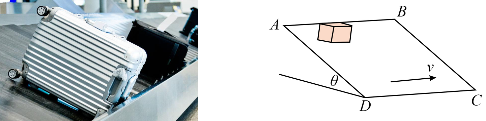

# Physics - 题目 2639

**ID**: 8e0a623b28444b48ad1439084f4ed41f
**年级**: Grade 12
**难度**: Easy
**题型**: Multiple-choice

## 题目
机场行李倾斜传送带是机场行李处理系统中的一个重要组成部分，它能够帮助机场快速、准确地处理旅客的行李，提高机场的运营效率和服务质量。​​​​​​​‌倾斜传送带可简化为平面ABCD，以速度v沿AB方向匀速运动，倾斜传送带平面与水平面的夹角为 $θ$ ，物体与传送带间的动摩擦因素为 $μ$ ，重力加速度为g，则将质量为m的物体轻放到传送带上的瞬间，物体的加速度大小为（      ）

## 解答

1. 因摩擦力方向与相对运动方向相反，所以摩擦力方向在斜面上与v方向相同，大小为 ${\rm }{\rm μm}g{\cos}θ$ ，沿斜面方向合力为 $mg\sin θ$ ，所以合力为 $\sqrt {m{^{2}}g{^{2}}\sin {^{2}}θ+μ{^{2}}m{^{2}}g{^{2}}{\cos}{^{2}}θ}{\rm }$ ，根据牛顿第二定律可知，加速度 $a=\frac {F{{}_{合}}}{m}=\sqrt {g{^{2}}\sin {^{2}}θ+μ{^{2}}g{^{2}}{\cos}{^{2}}θ}$ 。

## 知识点

**中文**:
  - 牛顿第二定律的简单计算

**English**:
  - Simple Calculations of Newton's 2nd Law

---
