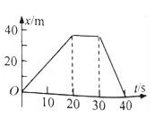

# Physics - 题目 1645

**ID**: 955d37e4d78a46fdbcbc327ea969d9de
**年级**: Grade 12
**难度**: Easy
**题型**: Multiple-choice

## 题目
一辆汽车沿平直道路行驶，其位移时间图象x﹣t如图所示，在t＝0到t＝40s这段时间内，汽车的平均速度大小是（      ）​​​​​​​‌

## 解答

1. 由图知，t_{1}=0时x_{1}=0，t_{2}=40s时，x_{2}=0，所以在t＝0到t＝40s这段时间内汽车的位移为∆x=x_{2}-x_{1}=0，汽车的平均速度大小为： $\bar v=\frac {Δx}{Δt}=0m/s$ ，故A正确，BCD错误；

## 知识点

**中文**:
  - x-t图像及其应用
  - 平均速度公式的应用

**English**:
  - x-t Graphs and Applications
  - Applications of Average Velocity Formula

---
