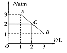

# Physics - 题目 668

**ID**: 96298529118f475182a0dbbd459065f3
**年级**: Grade 12
**难度**: Easy
**题型**: Multiple-choice

## 题目
如图所示，一定质量的理想气体，由状态A沿直线AB变化到B，在此过程中。​​​​​​​‌气体分子的平均速率的变化情况是

## 解答

1. 根据pV=CT，C不变，pV越大，T越高。C状态温度最高。在A和B状态pV乘积相等，所以温度先升高，后又减小到初始温度；由于温度是分子平均动能的标志，所以分子的平均动能先增大后减小，对于同种分子，速率先增大后减小。
2. 故选D。

## 知识点

**中文**:
  - 气体的p-V图像问题

**English**:
  - p-V Graph Problems

---
