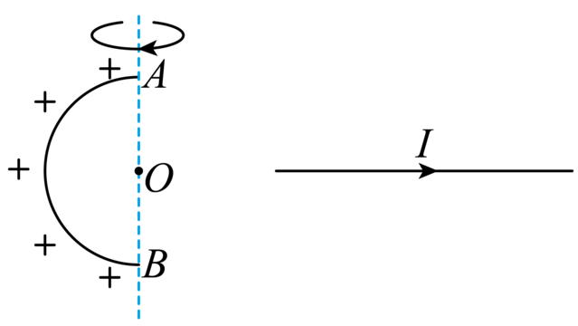

# Physics - 题目 1183

**ID**: acaea66d37174ab9b3e0f69bffbf131e
**年级**: Grade 12
**难度**: Easy
**题型**: Multiple-choice

## 题目
如图所示，半圆形的绝缘环上均匀分布有正电荷，AB是竖直直径，直导线与圆心O等高且水平固定，直导线中有向右的恒定电流，将半圆环绕AB所在直线沿顺时针方向（从上向下看）匀速转动，则直导线受到的安培力方向（      ）​​​​​​​‌

## 解答

1. 将半圆环绕AB所在直线沿顺时针方向（从上向下看）匀速转动，从上向下看形成的等效电流沿顺时针方向，则电流在直导线处的磁场竖直向上，根据左手定则，直导线受到的安培力垂直纸面向外。选D。

## 知识点

**中文**:
  - 安培力的方向（左手定则）

**English**:
  - Direction of Ampere Force (Left-Hand Rule)

---
