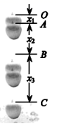

# Physics - 题目 1451

**ID**: b0dea1d0e4b2462582475a0e2f95ec30
**年级**: Grade 12
**难度**: Easy
**题型**: Multiple-choice

## 题目
如图，苹果自由下落时频闪照片的效果图，第一次闪光时苹果位于O点，第二、第三、第四次闪光时苹果分别位于A、B、C三点。​​​​​​​‌已知AB=x_{2}，OA=x_{1}，BC=x_{3}，频闪仪的闪光周期为T。进一步研究可知，苹果在自由下落过程中加速度保持不变。从受力的角度分析，这是因为苹果所受的合力（      ）

## 解答

1. 由题知，苹果在自由下落过程中加速度保持不变，根据牛顿第二定律
2. $F{{}_{合}}=ma$
3. 可知，这是因为苹果所受的合力保持不变。故ACD错误，B正确；
4. 故选B。

## 知识点

**中文**:
  - 牛顿第二定律的简单计算

**English**:
  - Simple Calculations of Newton's 2nd Law

---
