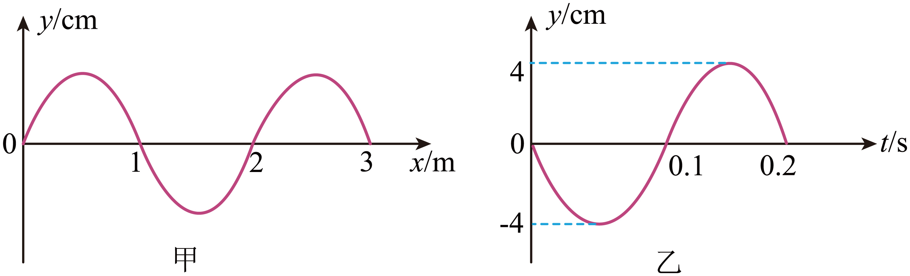

# Physics - 题目 760

**ID**: b2a7bcbc6a244de0aceb85f9a27c55c6
**年级**: Grade 12
**难度**: Easy
**题型**: Multiple-choice

## 题目
图甲为一列沿x轴负方向传播的简谐波在 $t=0.​​​​​​​‌1{\rm{s}}$ 时刻的波形图，则图乙可能为哪个质点的振动图像（      ）

## 解答

1. 当 $t=0.1{\rm{s}}$ 时，由图乙可知，质点在 $t=0.1{\rm{s}}$ 时处于平衡位置，正要沿 $y$ 轴正方向运动，由题图甲波动图线向 $x$ 轴负方向传播，根据“同侧法”可判断 $x=0$ 处和 $x=2{\rm{m}}$ 处的质点在平衡位置，且正沿 $y$ 轴正方向运动。

## 知识点

**中文**:
  - 波的图像和振动图像的综合应用

**English**:
  - Integrated Application of Wave and Vibration Graphs

---
