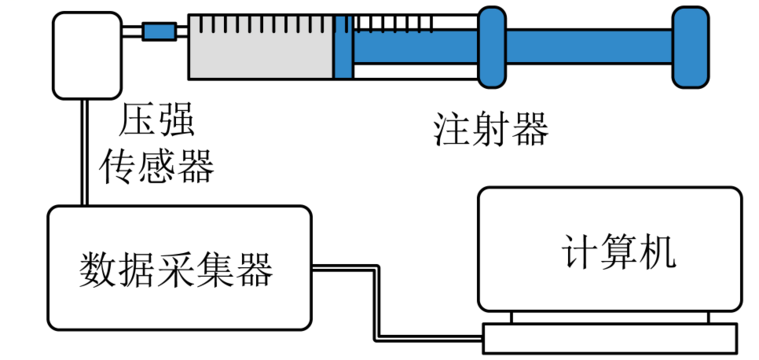

# Physics - 题目 1367

**ID**: b97c947536c344b9b4eb6ea094d9c8ee
**年级**: Grade 12
**难度**: Easy
**题型**: Multiple-choice

## 题目
如图所示，用气体压强传感器“探究等温情况下一定质量气体压强与体积的关系”，下列说法正确的是（      ）​​​​​​​‌

## 解答

1. A．实验时注射器如何放置对实验结果没有影响，A错误；
2. B．推拉活塞时，动作要慢，使其温度与环境保持一致，B错误；
3. C．活塞移至某位置时，应等状态稳定后再记录数据，C正确；
4. D．注射器中封闭一定质量的气体，用压强传感器与注射器相连，通过数据采集器和计算机可以测出注射器中封闭气体的压强，体积可以从注射器上的刻度读出，D错误。选C。

## 知识点

**中文**:
  - 实验：探究气体压强与体积的关系

**English**:
  - Experiment: Investigating Pressure vs Volume

---
