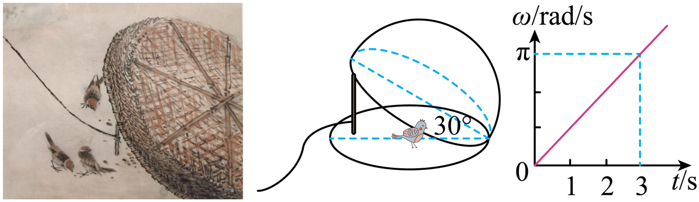

# Physics - 题目 2483

**ID**: bd1e15868f1c41dfab25d9c5f5df0274
**年级**: Grade 12
**难度**: Easy
**题型**: Multiple-choice

## 题目
鲁迅先生的《从百草园到三味书屋》中有一段描写：扫开一块雪，露出地面，用一枝短棒支起一面大的竹筛来，下面撒些秕谷，棒上系一条长绳，人远远地牵着，看鸟雀下来啄食，走到竹筛底下的时候，将绳子一拉，便罩住了。​​​​​​​‌如下左图为情景画，中图为模型简图，竹筛视为一个半径为R=0.5m的半球壳，初始用短棒在左侧支撑住，竹筛底面与地面夹角为30°，小鸟视为质点，在竹筛落地时的底面圆心处偷吃谷子，此时绳子拉动，短棒拉走，竹筛开始落下，绕着右端支点转动，其角速度随时间的图像如下右图所示，小鸟被惊动，立刻开始沿着半径向外逃窜，做速度为0.2m/s的匀速直线运动，下列说法正确的是（      ）

## 解答

1. 由图可知角速度逐渐增大，则竹筛上面各点的运动不是匀速圆周运动，故A错误；根据 $a=rω{^{2}}$ 可知，竹筛上面各点的加速度大小增大，故B错误；设竹筛从开始运动到落地的时间为t，根据角速度变化图像可知 $θ=\frac {1}{2}\cdot \frac {π}{3}t{^{2}}=\frac {π}{6}$ ，解得 $t=1{\rm s}$ ，故C正确；小鸟做匀速直线运动，t内的位移为 $x=vt=0.2{\rm{m}}{\rm{<}}R$ ，可知小鸟不能逃离竹筛，故D错误。

## 知识点

**中文**:
  - 匀速圆周运动及其性质
  - 线速度、角速度和周期、转速

**English**:
  - Uniform Circular Motion and its Properties
  - Linear Velocity, Angular Velocity, Period, and Rotational Speed

---
