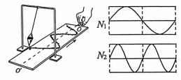

# Physics - 题目 570

**ID**: c4e9e118c7b54768a27ef76b84cf25c7
**年级**: Grade 12
**难度**: Easy
**题型**: Multiple-choice

## 题目
甲乙两位同学分别使用图中左图所示的同一套装置，观察单摆做简谐运动时的振动图象，已知两人实验时所用的摆长相同，落在同一木板上的细砂分别形成的曲线如右图N_{1}、N_{2}所示。​​​​​​​‌下面关于两图线相关的分析，正确的是（      ）

## 解答

1. A．由图可知，N_{1}、N_{2}的摆动幅度一样，故A错误；
2. B．因两摆的摆长相等，则由单摆的周期公式 $T=2π\sqrt {\frac {L}{g}}$ 可知，两摆的周期相同，故B错误；
3. C．由图可知，N_{1}的时间为T，N_{2}的时间为2T，则由 $v=\frac {x}{t}$ 可知，N_{1}对应的木板运动速度为N_{2}对应的木板运动速度的2倍，故C正确；
4. D．因为N_{1}、N_{2}的摆动幅度一样，故它们在最低点时的速度相等，由牛顿第二定律可求出摆线的拉力为
5. $T=mg+m\frac {v{^{2}}}{L}$
6. 在上式中，v、L相同，因使用同一套装置质量相同，故摆线的拉力相等，故D错误。
7. 故选C。

## 知识点

**中文**:
  - 单摆周期公式及其应用
  - 振幅、周期、频率、相位和波长及其计算

**English**:
  - Pendulum Period Formula and Applications
  - Calculation of Amplitude, Period, Frequency, Phase, and Wavelength

---
