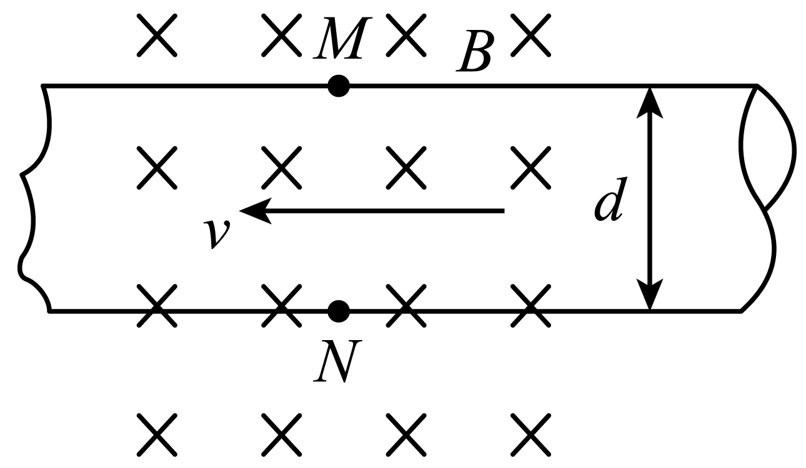

# Physics - 题目 487

**ID**: e49cf80099cf49038e6ee8f9d2d94395
**年级**: Grade 12
**难度**: Easy
**题型**: Multiple-choice

## 题目
新冠肺炎疫情持续期间，医院需要用到血液流量计检查患者身体情况。​​​​​​​‌某种电磁血液流量计的原理可简化为如图所示模型。血液内含有少量正、负离子，从直径为d的血管右侧流入，左侧流出，空间有垂直纸面向里、磁感应强度大小为B的匀强磁场，M、N两点之间的电压稳定时测量值为U，流量Q等于单位时间通过横截面的液体的体积。下列说法正确的是（      ）

## 解答

1. AB．由左手定则可知，水平向左入射的正离子受竖直向下的洛伦兹力，负离子受竖直向上的洛伦兹力，则正电荷聚集在N一侧，负电荷聚集在M一侧，则N点电势高于M点电势，AB错误；
2. C．电压稳定后，离子所受的洛伦兹力等于电场力，即 $qBv=q\frac {U}{d}$ ，可得流速为 $v=\frac {U}{Bd}$ ，则流量Q为 $Q=Sv=π(\frac {d}{2}){^{2}}v=\frac {πUd}{4B}$ ，C正确；
3. D．电压稳定时，正、负离子受到的洛伦兹力与电场力平衡，D错误。选C。

## 知识点

**中文**:
  - 电磁流量计

**English**:
  - Electromagnetic Flowmeter

---
