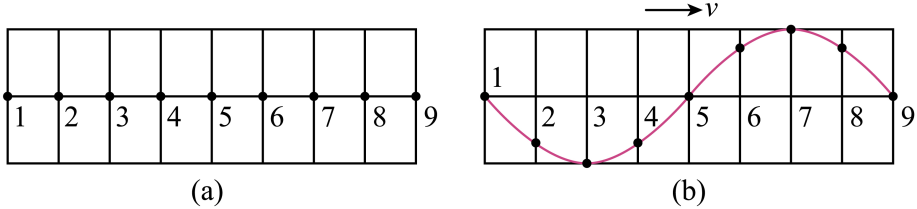

# Physics - 题目 2393

**ID**: ea9e3ddf197f4f218155400143d3cc24
**年级**: Grade 12
**难度**: Easy
**题型**: Multiple-choice

## 题目
在一均匀介质中选取平衡位置在同一直线上的9个质点，相邻两质点间的距离均为 $0.2{\rm{m}}$ ，如图（a）所示，一列横波沿该直线向右传播， $t=0$ 时到达质点1，质点1开始向下运动，振幅为 $0.05{\rm{m}}$ ，经过时间 $0.6{\rm{s}}$ 第一次出现如图（b）所示的波形。​​​​​​​‌则（      ）

## 解答

1. A．因为一列横波沿该直线向右传播， $t=0$ 时到达质点1，质点1开始向下运动，则该时刻的波前在第13个质点处，向右传播了 $1.5$ 个波长，质点1振动了 $1.5$ 个周期，所以 $1.5T=0.6$ ，解得 $T=0.4{\rm{s}}$ ，该波的周期为 $0.4{\rm{s}}$ ，A错误；
2. B．该波的波速为 $v=\frac {λ}{T}=\frac {8\times 0.2}{0.4}{\rm{m}}{\rm{/}}{\rm{s}}=4{\rm{m}}{\rm{/}}{\rm{s}}$ ，B错误；
3. C．因为 $t=0$ 时到达质点1，质点1开始向下运动，所以第9个质点开始振动的方向向下，C错误；
4. D．质点1在 $0.6{\rm{s}}$ 内运动的路程为 $x=1.5\times 4A=1.5\times 4\times 0.05{\rm{m}}=0.3{\rm{m}}$ ，D正确。
5. 选D。

## 知识点

**中文**:
  - 波长、频率和波速的关系及应用

**English**:
  - Relationship between Wavelength, Frequency, Wave Speed

---
