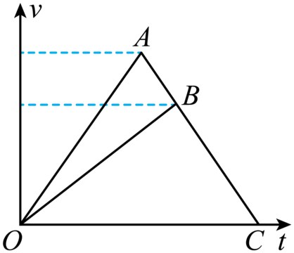

# Physics - 题目 2222

**ID**: f36133464f014d028dc623f7c004f032
**年级**: Grade 12
**难度**: Easy
**题型**: Multiple-choice

## 题目
一物块静止在水平面上，在外力作用下运动。​​​​​​​‌第一次用大小为 $F{{}_{1}}$ 的水平恒力作用在物块上，运动一段时间后，撤去 $F{{}_{1}}$ ，物块整个运动过程的 $v-t$ 图像为OAC；第二次用大小为 $F{{}_{2}}$ 的水平恒力作用在物块上，运动一段时间后，撤去 $F{{}_{2}}$ ，物块整个运动过程的 $v-t$ 图像为OBC。则下列说法正确的是（      ）

## 解答

1. AB．整个过程，两次摩擦力冲量相同，根据动量定理可知，两次水平恒力的冲量大小相等，AB错误；
2. CD．由于第一次运动的位移大，克服摩擦力做功多，整个过程根据动能定理 $W{{}_{{\rm{F}}}}-W{{}_{{\rm{f}}}}=0-0$ ，第一次水平恒力做功多，C正确，D错误。选C。

## 知识点

**中文**:
  - 动量定理及其应用
  - 应用动能定理求解与图像相关的动能问题

**English**:
  - Applications of Impulse-Momentum Theorem
  - Graph-related Kinetic Energy Problems

---
