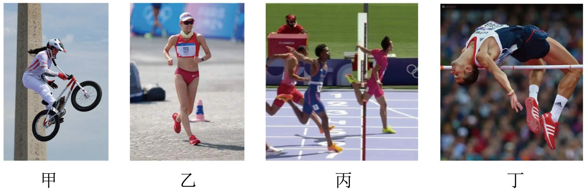

# Physics - 题目 489

**ID**: f8ba8af062b7412ba3a616e6ed096a36
**年级**: Grade 12
**难度**: Easy
**题型**: Multiple-choice

## 题目
如图所示为运动会中的四个比赛场景。​​​​​​​‌下列对各场景的阐述中正确的是（      ）

## 解答

1. A．在运动员展示小轮车骑行技巧时，运动员的身体姿态不能忽略，不可将其看成质点，故A错误；
2. B．运动员在参加田径女子20公里竞走，“20公里”指的是比赛过程中的路程，故B错误；
3. C．运动员在4×100米决赛跑出38秒06，“38秒06”指的是时间间隔，故C错误；
4. D．运动员跳高下落时，通过海绵垫可增加接触面与运动员的作用时间从而实现缓冲，根据 $Ft=Δp$ 可知，可以减小地面对运动员的作用力，故D正确。
5. 故选D。

## 知识点

**中文**:
  - 动量定理及其应用
  - 描述运动的基本概念

**English**:
  - Applications of Impulse-Momentum Theorem
  - Basic Concepts of Motion

---
