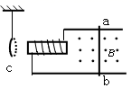

# Physics - 题目 2209

**ID**: fbc76140751640a799646a9721fcaf4f
**年级**: Grade 12
**难度**: Easy
**题型**: Multiple-choice

## 题目
如图所示，放在不计电阻的金属导轨上的导体棒ab, 在匀强磁场中沿导轨做下列哪种运动时，钢制闭合线圈c将被螺线管吸引（      ）​​​​​​​‌

## 解答

1. 钢制闭合线圈c被螺线管吸引，根据楞次定律可知通过闭合线圈c的磁场在减弱，即螺线管中的磁场在减弱，导体棒切割磁感线产生的电流在螺旋管中产生磁场，所以导体棒切割磁感线产生的电流在减小，电动势也在减小，根据 $E=BLv$ ，可知导体棒应该减速运动
2. A． 向右做匀速运动，与分析不符，故A错误；
3. B．向左做匀速运动，与分析不符，故B错误；
4. C． 向右做减速运动，与分析相符，故C正确
5. D． 向右做加速运动，与分析不符，故D错误；

## 知识点

**中文**:
  - 楞次定律及其应用

**English**:
  - Lenz's Law and Applications

---
