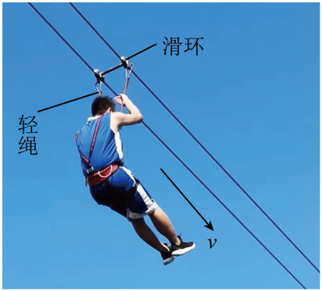

# Physics - 题目 1415

**ID**: 0a7b9a1f939345fea3746eab881f2960
**年级**: Grade 12
**难度**: Easy
**题型**: Multiple-select

## 题目
如图所示为高空滑索运动，游客利用轻绳通过轻质滑环悬吊沿倾斜滑索下滑。​​​​​​​‌假设某段下滑过程中游客、滑环和轻绳为整体匀速下滑，速度大小为v，整体重力为G，不计空气阻力，在这段下滑过程中下列说法正确的是（      ）

## 解答

1. A．匀速下滑过程中，动能保持不变，重力势能减小，因此机械能减少，A错误；B．由于游客匀速下滑，人受到重力与绳子拉力平衡，因此轻绳沿竖直方向，B正确；C．由于动能保持不变，而重力势能减小，因此整体重力势能的减少量大于系统动能的增加量，C正确；D．由于游客沿倾斜滑索下滑，因此重力的功率 $P=Gv\sin θ<Gv{\rm ，D}$ 错误。故选BC。

## 知识点

**中文**:
  - 重力势能的变化与重力做功的关系

**English**:
  - Change in Gravitational PE and Work Done by Gravity

---
