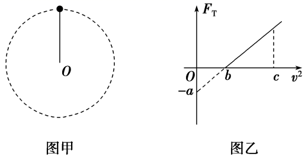

# Physics - 题目 169

**ID**: 1c77d20fc7664217a06ca313a7393f57
**年级**: Grade 12
**难度**: Easy
**题型**: Multiple-select

## 题目
如图甲所示，用一轻质绳拴着一质量为m的小球，在竖直平面内做圆周运动（不计一切阻力），小球运动到最高点时绳对小球的拉力为F_{T}，小球在最高点的速度大小为v，其 $F{{}_{T}}-v{^{2}}$ 图象如图乙所示，则（      ）​​​​​​​‌

## 解答

1. AB．在最高点，根据牛顿第二定律得
2. $F{{}_{{\rm{T}}}}+mg=m\frac {v{^{2}}}{L}$
3. 解得
4. $F{{}_{{\rm{T}}}}=m\frac {v{^{2}}}{L}-mg$
5. 可知纵轴截距的绝对值为a＝mg，解得当地的重力加速度为 $g=\frac {a}{m}$ ，图线的斜率
6. $k=\frac {a}{b}=\frac {m}{L}$
7. 解得绳子的长度
8. $L=\frac {mb}{a}$
9. 故AB正确；
10. C．当v^{2}＝c时，轻质绳的拉力大小为
11. $F{{}_{{\rm{T}}}}=m\frac {c}{L}-mg=\frac {ac}{b}-a$
12. 故C错误；
13. D．当v^{2}＝b时拉力F_{T}为零，到最低点时根据动能定理得
14. $2mgL=\frac {1}{2}mv{{}_{1}^{2}}-\frac {1}{2}mv{^{2}}$
15. 根据牛顿第二定律得
16. $F^{′}{{{}_{{\rm{T}}}}}-mg=m\frac {v{{}_{1}^{2}}}{L}$
17. 联立以上可得拉力为
18. $F^{′}{{{}_{{\rm{T}}}}}=6mg=6a$
19. 故D正确。
20. 故选ABD。

## 知识点

**中文**:
  - 向心力的计算及应用
  - 竖直面内圆周运动问题

**English**:
  - Calculation and Application of Centripetal Force
  - Circular Motion in Vertical Plane

---
