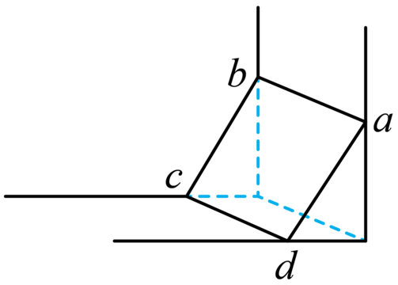

# Physics - 题目 2544

**ID**: fa5eca73dc274a24aa061e6206afdcdf
**年级**: Grade 12
**难度**: Easy
**题型**: Multiple-select

## 题目
正方形金属线框 $abcd$ 如图靠墙放置，空间中存在竖直向上的匀强磁场。​​​​​​​‌在外力作用下 $ab$ 边贴着墙面向下运动， $cd$ 边贴着水平面向左运动，此过程中线框的（      ）

## 解答

1. AB．设线圈平面与水平面的夹角为θ，则磁通量
2. $Φ{\rm{=}}BS{\cos}θ$
3. 则随θ角的减小，磁通量增加，选项A正确，B错误；
4. CD．根据楞次定律可知，穿过线圈的磁通量向上增加，则线圈中产生的感应电流方向为 $adcba$ ，选项C错误，D正确。
5. 故选AD。

## 知识点

**中文**:
  - 楞次定律及其应用
  - 磁通量

**English**:
  - Lenz's Law and Applications
  - Magnetic Flux

---
