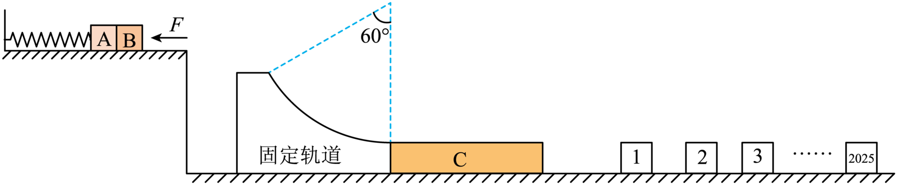

# Physics - 题目 1042

**ID**: 04dc77032f1c4f9fb158dd142dd8214c
**年级**: Grade 12
**难度**: Hard
**题型**: Calculation

## 题目
如图所示，光滑的台面左侧固定有一根劲度系数为 $k=200{\rm{N}}/{\rm{m}}$ 的轻弹簧，轻弹簧的右侧与质量为 $m=1{\rm{k}}{\rm{g}}$ 的滑块A栓接，质量也为m的滑块B紧靠滑块A一起静止在台面上。​​​​​​​‌台面右侧下方光滑的地面上固定有一圆心角为 $60{}\degree $ 、半径 $R=0.5{\rm{m}}$ 的光滑圆弧轨道，一表面与圆弧轨道右端相切且质量为 $\frac {1}{2}m$ 的长木板C与圆弧轨道接触不粘连，在C的右侧放着2025个质量均为m的滑块（视为质点），C和滑块均静止。现用恒力 $F=10{\rm{N}}$ 向左推动滑块B，当滑块A、B速度为0时，撤去恒力F，此后某时刻，滑块B与滑块A分离，分离后滑块A在台面上做简谐运动，滑块B从平台右侧飞出，恰好从圆弧轨道左端沿切线方向滑入，一段时间后滑上C。当B、C刚共速时，C恰好与滑块1发生第1次碰撞。一段时间后，B、C再次共速时，C恰好与滑块1发生第2次碰撞，此后B、C共速时，C总是恰好与滑块1发生碰撞；物块B始终未从C上滑落，若C与B之间的动摩擦因数 $μ=0.2$ ，重力加速度为 $g=10{\rm{m}}/{\rm{s}}{^{2}}$ ，所有碰撞均为弹性碰撞，且每次碰撞时间极短。弹性势能公式 $E{{}_{{\rm{p}}}}=\frac {1}{2}kx{^{2}}$ ，其中k为弹簧劲度系数，x为弹簧形变量。求：（1）滑块A做简谐运动的振幅A；（结果用根号表示）（2）滑块B在圆弧轨道最低点时对轨道的压力大小；（3）滑块C最后一次与滑块1发生碰撞前，滑块1的总路程。

## 解答

1. （1）设对A、B向左运动最大距离为x，由功能关系得 $Fx=\frac {1}{2}kx{^{2}}$
2. 撤去力后A、B在弹簧原长处分离，由能量守恒得 $\frac {1}{2}kx{^{2}}=\frac {1}{2}\times 2mv{{}_{0}^{2}}$
3. 此后滑块A做简谐运动时动能转化为弹性势能，由能量守恒得 $\frac {1}{2}mv{{}_{0}^{2}}=\frac {1}{2}kA{^{2}}$
4. 解得滑块A做简谐运动的振幅 $A=\frac {\sqrt {2}}{20}{\rm{m}}$ ， $v{{}_{0}}=1{\rm{m}}/{\rm{s}}$
5. （2）由数学知识可得B抛出后到达固定轨道时速度 $v=\frac {v{{}_{0}}}{{\cos}60{}\degree }=2{\rm{m}}/{\rm{s}}$
6. B在固定轨道上滑到最低点的过程由动能定理得 $mgR\left ({1-{\cos}60{}\degree }\right )=\frac {1}{2}mv^{′}{{^{2}}}-\frac {1}{2}mv{^{2}}$
7. B在最低点时由牛顿第二定律得 $F{{}_{{\rm{N}}}}-mg=m\frac {v^{′}{{^{2}}}}{R}$
8. 联立代入数据得 $F{{}_{{\rm{N}}}}=28{\rm{N}}$
9. 由牛顿第三定律得B对轨道的压力大小为 $F^{′}{{{}_{{\rm{N}}}}}=F{{}_{{\rm{N}}}}=28{\rm{N}}$
10. （3）B滑上C后和C构成的系统动量守恒，到共速时据动量守恒得 $mv^{′}=\left ({m+\frac {1}{2}m}\right )v{{}_{10}}$
11. C和1弹性碰撞，据动量守恒有 $\frac {1}{2}mv{{}_{10}}=\frac {1}{2}mv{{}_{{\rm{C}}1}}+mv{{}_{1}}$
12. 据能量守恒有 $\frac {1}{2}\times \frac {1}{2}mv{{}_{10}^{2}}=\frac {1}{2}\times \frac {1}{2}mv{{}_{{\rm{C}}1}^{2}}+\frac {1}{2}mv{{}_{1}^{2}}$
13. 此后1和2碰撞，1保持静止；2和3碰撞，2保持静止；……碰后C和B再次共速，据动量守恒有 $\frac {1}{2}mv{{}_{{\rm{C}}1}}+mv{{}_{10}}=\left ({\frac {1}{2}m+m}\right )v{{}_{20}}$
14. 由牛顿第二定律得 ${\rm μm}g=\frac {1}{2}ma$
15. 由运动学公式得C前进的位移 $x{{}_{1}}=\frac {v{{}_{20}^{2}}-v{{}_{{\rm{C}}1}^{2}}}{2a}=\frac {8}{81}{\rm{m}}$
16. C和2弹性碰撞，据动量守恒有 $\frac {1}{2}mv{{}_{20}}=\frac {1}{2}mv{{}_{{\rm{C}}2}}+mv{{}_{2}}$
17. 据能量守恒有 $\frac {1}{2}\times \frac {1}{2}mv{{}_{20}^{2}}=\frac {1}{2}\times \frac {1}{2}mv{{}_{{\rm{C}}2}^{2}}+\frac {1}{2}mv{{}_{2}^{2}}$
18. 此后1和2碰撞，1保持静止；2和3碰撞，2保持静止；……，碰后C和B再次共速，据动量守恒有 $\frac {1}{2}mv{{}_{{\rm{C}}2}}+mv{{}_{20}}=\left ({\frac {1}{2}m+m}\right )v{{}_{30}}$
19. 由运动学公式得C前进的位移 $x{{}_{2}}=\frac {v{{}_{30}^{2}}-v{{}_{{\rm{C}}2}^{2}}}{2a}=\frac {25}{81}\times \frac {8}{81}{\rm{m}}$
20. 得C第2024次碰1后，C前进的位移为 $x{{}_{2024}}={\left({\frac {25}{81}}\right)^{2023}}\times \frac {8}{81}{\rm{m}}$
21. 每两次碰撞过程中，C前进的位移即滑块1前进的位移，滑块1前进后和滑块2碰撞，然后等滑块C刚好共速时来撞滑块1，即滑块C的位移和为滑块1的总路程 $s=\frac {\left [1-{\left({\frac {25}{81}}\right)^{2024}}\right ]}{1-\frac {25}{81}}\times \frac {8}{81}{\rm{m}}=\frac {1}{7}\left [1-{\left({\frac {25}{81}}\right)^{2024}}\right ]{\rm{m}}$

## 知识点

**中文**:
  - 动量守恒中的多次碰撞问题

**English**:
  - Multiple Collisions in Momentum Conservation

---
