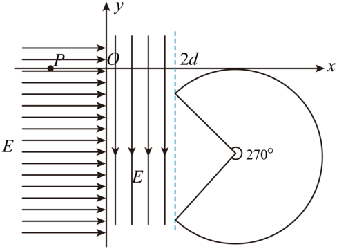

# Physics - 题目 2254

**ID**: 0f06a8f9ac264e6ba426cafe5383ba40
**年级**: Grade 12
**难度**: Hard
**题型**: Calculation

## 题目
平面直角坐标系xOy的二、三象限存在沿x轴正方向的匀强电场，电场强度大小为E，在一，四象限内的0<x≤2d区域内存在电场强度大小也为E、方向沿y轴负方向的匀强电场，在第四象限x>2d的区域内存在一边界为270°圆弧的匀强磁场区域，圆弧与x轴相切，开口在直线x=2d上，圆弧半径为 $R=\left ({2+\sqrt {2}}\right )d$ ，磁场方向未画出，如图所示。​​​​​​​‌质量为m、电荷量为＋q的带电粒子从 $P\left ({-d,0}\right )$ 点由静止释放，粒子最终恰好从圆弧与x轴的切点飞出，已知 ${\tan}50.4{}\degree =\frac {\sqrt {2}+1}{2}$ ，不计粒子重力，求：（1）粒子通过一、四象限的电场后速度方向偏转的角度 $θ$ ；（2）匀强磁场的磁感应强度B；（3）若匀强磁场的磁感应强度变为第（2）问磁感应强度的一半，则粒子在磁场中运动的时间为多少？

## 解答

1. （1）粒子从P点运动到O点，根据动能定理有 $Eqd=\frac {1}{2}mv{{}_{0}^{2}}$ ，
2. 解得粒子在O点的速度为 $v{{}_{0}}=\sqrt {\frac {2Eqd}{m}}$ ，
3. 粒子进入一、四象限的电场后做类平抛运动，根据类平抛运动规律可得粒子在一、四象限的电场中的运动时间为 $t=\frac {2d}{v{{}_{0}}}$ ，
4. 根据牛顿第二定律有 $Eq=ma$ ，
5. 离开一、四象限的电场时在竖直方向上的分速度为 $v{{}_{{\rm{y}}}}=at$ ，
6. 则粒子通过一、四象限的电场后速度方向偏转角度的正切值为 ${\tan}θ=\frac {v{{}_{{\rm{y}}}}}{v{{}_{0}}}$ ，
7. 联立解得 $θ=45{^{\circ }}$ 。
8. （2）粒子离开一、四象限的电场时的速度为 $v=\sqrt {2}v{{}_{0}}$ ，
9. 粒子在一、四象限的电场中的偏转位移为 $y=\frac {1}{2}at{^{2}}=d$ ，
10. 则粒子恰好由图中的A点沿 $AO{{}_{0}}$ 方向射入磁场，其中 $O{{}_{0}}$ 为圆弧磁场的圆心，粒子轨迹如下图所示
11. 
12. 根据几何知识可得 $r+r\sin 45{^{\circ }}=R{\cos}45{^{\circ }}$ ，
13. 解得，粒子在磁场中做匀速圆周运动的轨迹半径为 $r=\sqrt {2}d$ ，
14. 根据洛伦兹力提供向心力有 $Bqv=m\frac {v{^{2}}}{r}$ ，
15. 解得匀强磁场的磁感应强度为 $B=\sqrt {\frac {2mE}{qd}}$ ，
16. 由左手定则判断可知，磁感应强度的方向垂直纸面向里。
17. （3）由上述分析可得 $r=\frac {mv}{Bq}$ ，
18. 若匀强磁场的磁感应强度变为第（2）问磁感应强度的一半，则粒子的轨迹半径为 $r{{}_{2}}=2r=2\sqrt {2}d$ ，
19. 粒子运动轨迹如下图所示
20. 
21. 则根据几何知识有 ${\tan}α=\frac {R}{r{{}_{2}}}=\frac {\sqrt {2}+1}{2}$ ，
22. 则有 $α=50.4{^{\circ }}$ ，
23. 即 $2α=\frac {14π}{25}$ ，
24. 则粒子在磁场中运动的时间为 $t{{}_{2}}=\frac {\frac {14π}{25}r{{}_{2}}}{v}=\frac {14π}{25}\sqrt {\frac {2md}{Eq}}$ 。

## 知识点

**中文**:
  - 带电粒子在组合场中的运动

**English**:
  - Motion in Combined Fields

---
