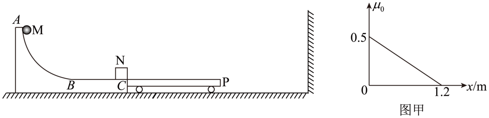

# Physics - 题目 1463

**ID**: 0fe56495e35a427a8d9e1a5baf1299d8
**年级**: Grade 12
**难度**: Hard
**题型**: Calculation

## 题目
如图所示，水平地面上左侧有一固定的圆弧斜槽，斜槽左端是四分之一光滑圆弧AB，圆弧半径为R=7.5m，右端是粗糙的水平面BC，紧挨着斜槽右侧有一足够长的小车P，小车质量为 $m_{0}=1{\rm{k}}{\rm{g}}$ ，小车左端和斜槽末端C平滑过渡但不粘连，在C点静止放置一滑块N（可视为质点）。​​​​​​​‌滑块质量为 $m_{1}=2{\rm{k}}{\rm{g}}$ ，最右边有一固定的竖直墙壁，小车右端距离墙壁足够远。已知斜槽BC段长度为L=1.2m，由特殊材料制成，从B点到C点其与小球间的动摩擦因数 $μ_{0}$ 随到B点距离增大而均匀减小到0，变化规律如图甲所示。滑块N与小车的水平上表面间的动摩擦因数为μ=0.1，水平地面光滑，现将一质量为 $m_{2}=2{\rm{k}}{\rm{g}}$ 小球M（可视为质点的）从斜槽顶端A点静止滚下，经过ABC后与静止在斜槽末端的滑块N发生弹性碰撞，碰撞时间极短，碰撞后滑块滑上小车，小车与墙壁相碰时碰撞时间极短，每次碰撞后小车速度方向改变，速度大小减小为碰撞前的一半，重力加速度取 $g=10{\rm{m}}{\rm{/}}{\rm{s}}^{2}$ ，求：（1）小球运动到C点时（还未与滑块碰撞）的速度大小；（2）小车与墙壁第1次碰撞后到与墙壁第2次碰撞前瞬间的过程中，滑块与小车间由于摩擦产生的热量；（3）小车与墙壁第1次碰撞后到与墙壁第5次碰撞前瞬间的过程中，小车运动的路程；（4）画出小车与墙壁前三次碰撞时间内小车和滑块的v—t图象，不要求推导过程。

## 解答

1. （1）若小球到C点的速度为 $v_{0}$ ，B到C过程中小球克服阻力做功为 $W_{{\rm{f}}_{BC}}$ ，由图甲可知过程摩擦力在均匀减小，则有
2. $W_{{\rm{f}}_{BC}}=\frac {1}{2}\times μ_{0}m_{2}gL=6{\rm{J}}$
3. 小球由A到C过程中，由动能定理可得
4. $m_{2}gR-W_{{\rm{f}}_{BC}}=\frac {1}{2}m_{2}v_{0}^{2}$
5. 解得
6. $v_{0}=12{\rm{m}}{\rm{/}}{\rm{s}}$
7. （2）小球与滑块弹性碰撞过程
8. $m_{2}v_{0}=m_{2}v^{′}_{2}+m_{1}v$
9. $\frac {1}{2}m_{2}v_{0}^{2}=\frac {1}{2}m_{2}v{_{2}^′}^{2}+\frac {1}{2}m_{1}v^{2}$
10. $m_{2}=m_{1}$
11. 联立方程组解得
12. $v^{′}_{2}=0$
13. $v=v_{0}=12{\rm{m}}{\rm{/}}{\rm{s}}$
14. 即由于小球与滑块质量相等，速度交换即碰后滑块速度大小为
15. $v=v_{0}=12{\rm{m}}{\rm{/}}{\rm{s}}$
16. 小球静止。滑块滑上小车后达到的共同速度为 $v_{1}$ ，滑块和小车第一次碰前，出动量守恒有
17. $m_{1}v=\left ({m_{1}+m_{0}}\right )v_{1}$
18. 第一次碰前小车和滑块速度均为 $v_{1}$ ，碰后小车变为 $-\frac {1}{2}v_{1}$ ，滑块速度仍为 $v_{1}$ ，碰后通过动量守恒，达到共同速度为 $v_{2}$ ，则由动量守恒有
19. $-\frac {1}{2}m_{0}v_{1}+m_{1}v_{1}=\left ({m_{1}+m_{0}}\right )v_{2}$
20. 由分析可知，当滑块和小车第二次共速后恰好发生第二次碰撞；小车与墙壁第1次碰撞后到与墙壁第2次碰撞前过程中，滑块与小车间产生的热量为Q，根据能量守恒得
21. $\frac {1}{2}m_{0}\left ({\frac {1}{2}v_{1}}\right )^{2}+\frac {1}{2}m_{1}v_{1}^{2}=\frac {1}{2}\left ({m_{1}+m_{0}}\right )v_{2}^{2}+Q$
22. 联立得
23. Q=48J
24. （3）以小车第一次碰后为即时起点，根据牛顿第二定律有，滑块与小车运动过程中加速度大小分别为
25. $a_{1}=\frac {μm_{1}g}{m_{1}}=lm/{\rm{s}}^{2}$
26. $a_{2}=\frac {μm_{1}g}{m_{3}}=2{\rm{m}}{\rm{/}}{\rm{s}}^{2}$
27. 小车向左减速到0用时为
28. $t_{1}=\frac {v_{1}}{2a_{2}}=2{\rm{s}}$
29. 路程为
30. $s_{1}=\frac {v_{1}}{4}t_{1}\times 2=8{\rm{m}}$
31. 此时，小车速度为
32. $a_{2}t_{1}=4{\rm{m}}{\rm{/}}{\rm{s}}$
33. 滑块的速度为
34. $v_{滑}=v_{1}-2a_{1}t_{1}=4{\rm{m}}{\rm{/}}{\rm{s}}$
35. 即滑块和小车在二次碰墙前恰好达到共速，分析可知，每次碰撞前两者恰好达到共同速度。
36. 小车与墙壁第1次碰撞到第2次碰撞过程中，路程
37. $s_{1}=8{\rm{m}}$
38. 同理小车与墙壁第2次碰撞到第3次碰撞过程中
39. $s_{2}=2{\rm{m}}$
40. 第3次碰撞到第4次碰撞过程中
41. $s_{3}=0.5{\rm{m}}$
42. 第4次碰撞到第5次碰撞过程中
43. $s_{4}=0.125{\rm{m}}$
44. 小车与墙壁第1次碰撞后到与墙壁第5次碰撞前瞬间的过程中，小车运动的路程s
45. $s=s_{1}+s_{2}+s_{3}+s_{4}=10.625{\rm{m}}$
46. （4）如图所示。（只需画出第三次碰撞前）
47. 【点睛】

## 知识点

**中文**:
  - 动量与牛顿定律的综合考查
  - 求解弹性碰撞问题
  - 动量和能量的综合应用

**English**:
  - Integration of Momentum and Newton's Laws
  - Solving Elastic Collision Problems
  - Integration of Momentum and Energy

---
