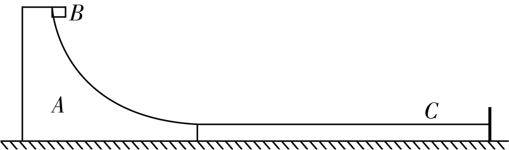

# Physics - 题目 2624

**ID**: 17e46cf3ba854b5bace5aa1c907a4906
**年级**: Grade 12
**难度**: Hard
**题型**: 方程式和演算步骤。

## 题目
（14分）如图所示，有一固定的光滑 $\frac{1}{4}$ 圆弧轨道A，半径R＝0.2 m，一质量为m_{B}＝1 kg的小滑块B从轨道顶端滑下，在其冲上长木板C左端时，给木板一个与小滑块相同的初速度，已知m_{C}＝3 kg，B、C间动摩擦因数μ_{1}＝0.2，C与地面间的动摩擦因数μ_{2}＝0.8，C右端有一个挡板，C长为L。​​​​​​​‌（重力加速度g取10 m/s^{2}）（1）B滑到A的底端时对A的压力是多大？（2）若B未与C右端的挡板碰撞，当B与地面保持相对静止时，B、C间因摩擦产生的热量是多少？（3）在0.16 m＜L＜0.8 m时，B与C右端的挡板发生碰撞，且碰后粘在一起，求B从滑上C到最终停止所用的时间。

## 解答

1. （1）滑块B下滑到圆弧轨道A底端时，由动能定理有 ${\rm \mathit{m}\mathit{_{B}}\mathit{gR}＝}\frac{1}{2}{\rm \mathit{m}\mathit{_{B}}\mathit{v}^{2}－0}$     	    	    	    	    	    	    	    	    	    	（1分）
2. 由圆周运动知识有 ${\rm \mathit{F}_{N}－\mathit{m}\mathit{_{B}}\mathit{g}＝\mathit{m}\mathit{_{B}}}\frac{{v}^{2}}{R}$（1分）
3. 解得F_{N}＝30 N    	    	    	    	    	    	    	    	（1分）
4. 由牛顿第三定律可知，B对A的压力大小为30 N    	    	    	    	（1分）
5. （2）当B滑上C的瞬间，B、C速度相等，假设二者之间无相对滑动，对B、C整体有μ_{2}（m_{B}＋m_{C}）g＝（m_{B}＋m_{C}）a，解得a＝8 m/s^{2}^{    	}^{    	}^{    	}（1分）
6. 而B的最大加速度a_{1}＝2 m/s^{2}，故假设不成立，B、C间会有相对滑动，则B的加速度大小为a_{1}＝2 m/s^{2}，方向向左，
7. 对C有μ_{2}（m_{B}＋m_{C}）g－μ_{1}m_{B}g＝m_{C}a_{2}_{    	}_{    	}_{    	}_{    	}_{    	}（1分）
8. 得a_{2}＝10 m/s^{2}，方向向左，
9. B向右运动的距离 ${\rm \mathit{x}_{1}＝}\frac{{v}^{2}}{2{a}_{1}}{\rm ＝1}$  m，
10. C向右运动的距离 ${\rm \mathit{x}_{2}＝}\frac{{v}^{2}}{2{a}_{2}}{\rm ＝0.2}$  m，
11. B、C间因摩擦产生的热量Q＝μ_{1}m_{B}g（x_{1}－x_{2}）    	    	    	    	（1分）
12. 解得Q＝1.6 J    	    	    	    	    	    	    	    	    	（1分）
13. （3）由（2）问可知，C先停下，B继续在C上运动，当B在C上向右运动x_{1}－x_{2}＝0.8 m才停下。
14. 设C从运动到停下所用的时间为t_{1}，由运动学知识可得
15. ${\rm \mathit{t}_{1}＝}\frac{v}{{a}_{2}}{\rm ＝0.2}$  s    	    	    	    	    	    	    	    	    	（1分）
16. 此时B、C的位移大小分别为
17. ${\rm \mathit{x}_{3}＝\mathit{vt}_{1}－}\frac{1}{2}{\rm \mathit{a}_{1}}$  ${t}_{1}^{2}{\rm ＝0.36}$  m，x_{2}＝0.2 m，
18. 则x_{相}＝0.16 m，此时v_{B}＝v－a_{1}t_{1}＝1.6 m/s    	    	    	    	    	（1分）
19. 由于L＞0.16 m，故一定是C停下之后，B才与C上挡板碰撞，
20. 设B与挡板碰撞时的速度大小为v_{B}_{0}，则由运动学知识有
21. ${v}_{B0}^{2}{\rm －}$  ${v}_{B}^{2}$ ＝－2a_{1}（L－0.16 m），
22. 解得 ${\rm \mathit{v}\mathit{_{B}}_{0}＝2}\sqrt{0.8-L}{\rm （SI）}$ ，
23. 所用时间 ${\rm \mathit{t}_{2}＝}\frac{{v}_{B0}-{v}_{B}}{-{a}_{1}}{\rm ＝0.8－}$  $\sqrt{0.8-L}{\rm （SI）}$     	    	    	    	    	（1分）
24. B与挡板碰撞时，由动量守恒定律有
25. m_{B}v_{B}_{0}＝（m_{B}＋m_{C}）v_{共}_{    	}_{    	}_{    	}_{    	}_{    	}_{    	}_{    	}（1分）
26. 解得v_{共}＝ $\frac{\sqrt{0.8-L}}{2}{\rm （SI）}$ ，
27. 之后二者一起减速，a_{3}＝μ_{2}g，经时间t_{3}后停下，
28. 有v_{共}＝μ_{2}gt_{3}，
29. 解得 ${\rm \mathit{t}_{3}＝}\frac{\sqrt{0.8-L}}{16}{\rm （SI）}$     	    	    	    	    	    	    	    	（1分）
30. 故总时间 ${\rm \mathit{t}＝\mathit{t}_{1}＋\mathit{t}_{2}＋\mathit{t}_{3}＝1－}\frac{15\sqrt{0.8-L}}{16}{\rm （SI）}$     	    	    	    	    	（1分）

## 知识点

**中文**:
  - 动量守恒与板块模型相结合

**English**:
  - Momentum Conservation with Plate Models

---
