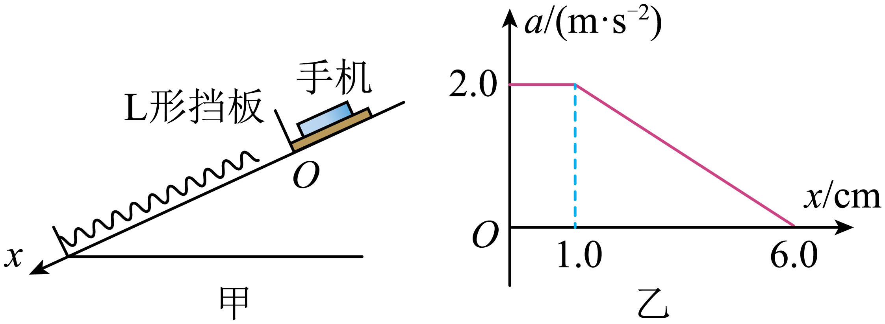

# Physics - 题目 364

**ID**: 1d3771dd8f0a445dada05466b048e373
**年级**: Grade 12
**难度**: Hard
**题型**: Calculation

## 题目
如图甲所示，地面上固定一倾角 $θ=37^{o}$ 的斜面，一轻弹簧与斜面平行放置，一端固定在斜面底端。​​​​​​​‌某同学将一智能手机固定在L形挡板上，现打开手机上的加速度传感器，同时让L形挡板和手机从斜面上某处由静止开始下滑。以释放处L形挡板的前端为坐标原点O，沿斜面向下建立Ox轴，通过投屏软件电脑屏幕上显示出挡板运动的加速度a与其位移x之间的部分关系如图乙所示。已知手机与L形挡板的总质量 $m=1.0{\rm{k}}{\rm{g}}$ ，弹簧始终处于弹性限度内，重力加速度g取 $10{\rm{m}}{\rm{/}}{\rm{s}}^{{\rm{2}}}$ ， ${\rm{s}}{\rm{i}}{\rm{n}}37^{o}=0.6$ ， ${\cos}37^{o}=0.8$ ， $\sqrt {1{\rm{.}}4}\approx 1.2$ 。求；（1）L形挡板与斜面间的动摩擦因数与弹簧的劲度系数；（2）弹簧的最大弹性势能 $E_{{\rm{p}}{\rm{m}}}$ ，（计算结果保留两位有效数字）

## 解答

1. （1）由图乙知挡板接触弹簧前的加速度大小为
2. $a_{0}=2.0{\rm{m}}{\rm{/}}{\rm{s}}$
3. 由牛顿第二定律有
4. $mg{\rm{s}}{\rm{i}}{\rm{n}}θ-μmg{\rm{c}}{\rm{o}}{\rm{s}}θ=ma_{0}$
5. 解得
6. $μ=0.5$
7. 当 $a=0$ 时弹簧被压缩长度为
8. $x=x_{2}-x_{1}=6.0{\rm{c}}{\rm{m}}-1.0{\rm{c}}{\rm{m}}=5.0{\rm{c}}{\rm{m}}$
9. 此时有
10. $mg{\rm{s}}{\rm{i}}{\rm{n}}θ=kx+μmg{\rm{c}}{\rm{o}}{\rm{s}}θ$
11. 解得
12. $k=40{\rm{N}}{\rm{/}}{\rm{m}}$
13. （2）设弹簧的最大压缩量为 $x_{3}$ 克服弹簧弹力做功为
14. $W_{{\rm{T}}}=\frac {0+kx_{3}}{2}x_{3}$
15. 由动能定理有
16. $\left ({mg{\rm{s}}{\rm{i}}{\rm{n}}θ-μmg{\rm{c}}{\rm{o}}{\rm{s}}θ}\right )\left ({x_{3}+x_{1}}\right )-W_{{\rm{T}}}=0$
17. 弹簧的最大弹性势能
18. $E_{{\rm{p}}{\rm{m}}}=W_{{\rm{T}}}$
19. 解得
20. $E_{{\rm{p}}{\rm{m}}}\approx 0.24{\rm{J}}$

## 知识点

**中文**:
  - 动能变化跟做功的关系

**English**:
  - Relationship between Kinetic Energy Change and Work

---
