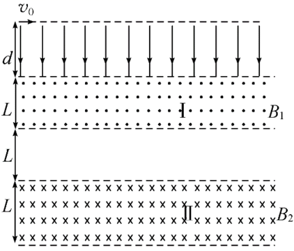

# Physics - 题目 2542

**ID**: 2b1f20b4a0e14e42856a8012663f5c4f
**年级**: Grade 12
**难度**: Hard
**题型**: Calculation

## 题目
在现代科学实验室中，经常用磁场来控制带电粒子的运动。​​​​​​​‌某仪器的内部结构简化如图：足够长的条形匀强磁场Ⅰ、Ⅱ宽度均为L，边界水平，相距也为L，磁场方向相反且垂直于纸面，Ⅰ区紧密相邻的足够长匀强电场，方向竖直向下，宽度为d，场强E＝ $\frac {3mv{{}_{0}}{^{2}}}{2qd}$。一质量为m，电量为＋q的粒子（重力不计）以速度v_{0}平行于纸面从电场上边界水平射入电场，并由A点射入磁场Ⅰ区（图中未标出A点）。不计空气阻力。(1)当B_{1}＝B_{0}时，粒子从Ⅰ区下边界射出时速度方向与边界夹角为 $60^\circ $ ，求B_{0}的大小及粒子在Ⅰ区运动的时间t；(2)若B_{2}＝B_{1}＝B_{0}，求粒子从Ⅱ区射出时速度方向相对射入Ⅰ区时速度方向的侧移量h；(3)若B_{1}＝B_{0}，且Ⅱ区的宽度可变，为使粒子经Ⅱ区恰能返回A点，求Ⅱ区的宽度最小值L_{x}和B_{2}的大小。

## 解答

1. (1)设粒子射入磁场Ⅰ区的速度大小为v，在电场中运动，由动能定理得
2. qEd＝ $\frac {1}{2}mv{^{2}}-\frac {1}{2}mv{{}_{0}^{2}}$
3. 解得
4. v＝2v_{0}
5. 速度与水平方向的夹角为α，
6. cosα＝ $\frac {v{{}_{0}}}{v}$ ＝ $\frac {1}{2}$
7. 则
8. α＝ $60^\circ $
9. 在磁场Ⅰ区中做圆周运动的半径为R_{1}，由牛顿第二定律得
10. qvB_{0}＝ $\frac {mv{^{2}}}{R{{}_{1}}}$
11. 由几何知识得
12. L＝2R_{1}cos $60^\circ $
13. 联立代入数据得
14. B_{0}＝ $\frac {2mv{{}_{0}}}{qL}$
15. 设粒子在磁场Ⅰ区中做圆周运动的周期为T，运动的时间为t
16. T＝ $\frac {2{\rm{π}}R{{}_{1}}}{v}$
17. t＝ $\frac {T}{6}$
18. 得
19. t＝ $\frac {{\rm{π}}L}{6v{{}_{0}}}$
20. (2)设粒子在磁场Ⅱ区做圆周运动的半径为R_{2}，R_{2}＝R_{1}轨迹如图乙所示，由几何知识可得
21. 
22. h＝L·sin $30^\circ $ ＋ $\frac {L{\sin}60^\circ }{{\cos}30^\circ }$ ＋L·sin $30^\circ $
23. 可得
24. h＝2L
25. (3)如图丙所示，为使粒子经Ⅱ区恰能返回射入Ⅰ区的A位置，应满足
26. 
27. Ltan $30^\circ $ ＝R_{2}′cos $30^\circ $
28. 则
29. L_{x}＝R_{2}′（1＋sin $30^\circ $ ）＝L
30. 解得
31. L_{x}＝L
32. 有
33. qvB_{2}＝ $\frac {mv{^{2}}}{R{{}_{2}^{\prime }}}$
34. 联立代入数据得
35. B_{2}＝ $\frac {3mv{{}_{0}}}{qL}$

## 知识点

**中文**:
  - 带电粒子在组合场中的运动

**English**:
  - Motion in Combined Fields

---
