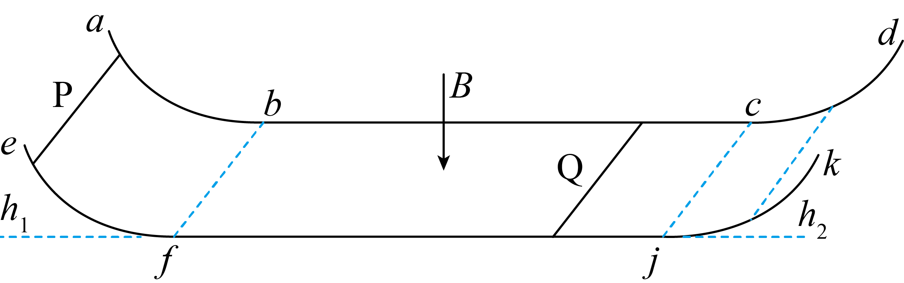

# Physics - 题目 651

**ID**: 2ca36221607e40aabd9ef2568a65d082
**年级**: Grade 12
**难度**: Hard
**题型**: Calculation

## 题目
如图所示，两光滑导轨 $abcd、efjk$ 平行且固定放置，其中 $ab、cd、ef、jk$ 为弯曲部分， $bc、fj$ 为水平部分，两导轨弯曲部分是绝缘的，水平部分是金属的、两导轨的间距为 $L$ 。​​​​​​​‌导轨的水平部分存在磁感应强度大小为 $B$ ，方向垂直向下的匀强磁场。导体棒 ${\rm{Q}}$ 垂直放置在导轨水平部分，导体棒 ${\rm{P}}$ 从导轨 $ab、ef$ 上距水平部分 $h{{}_{1}}$ 高度处静止释放。两导体棒质量均为 $m$ ，电阻均为 $R$ ，导轨电阻不计。在以后的运动过程中，导体棒 ${\rm{Q}}$ 第一次滑上 $cd、jk$ 部分上升的最大高度为 $h{{}_{2}}$ ，并且导体棒 ${\rm{Q}}$ 只能滑上 $cd、jk$ 部分两次，最终两导体棒静止在两导轨的水平部分，整个过程中两棒不会相撞。重力加速度为 $g$ ，求：（1）导体棒Q第二次滑上 $cd、jk$ 部分上升的最大高度：（2）两导体棒 ${\rm{P}}、{\rm{Q}}$ 都处于两导轨水平部分时，两导体棒间距离的变化量。

## 解答

1. （1）设导体棒P第一次运动到bf速度为vP_{0}，导体棒Q第一次运动到cj速度为vQ_{1}，根据机械能守恒，有 $mgh{{}_{1}}=\frac {1}{2}mv{{}_{P0}}{^{2}}$
2. $\frac {1}{2}mv{{}_{Q1}}{^{2}}=mgh{{}_{2}}$
3. 在磁场中，导体棒P、Q组成的系统动量守恒，导体棒Q第一次滑上cd、jk部分之前，有 $mv{{}_{P0}}=mv{{}_{P1}}+mv{{}_{Q1}}$
4. 根据机械能守恒定律知导体棒Q每次进入和离开cd、jk部分的速度大小相同，方向相反，则导体棒Q第二次滑上cd、jk部分之前，有 $mv{{}_{P1}}-mv{{}_{Q1}}=mv{{}_{P2}}+mv{{}_{Q2}}$
5. 题干已知导体棒Q只能滑上cd、jk部分两次，则导体棒Q第二次离开cd、jk部分到停下，有 $mv{{}_{P2}}-mv{{}_{Q2}}=0$
6. 导体棒Q第二次滑上cd、jk部分上升到最高点，根据机械能守恒，有 $\frac {1}{2}mv{{}_{Q2}}{^{2}}=mgh{{}_{2}}{^{\prime }}$
7. 联立解得 $h{{}_{2}}{^{\prime }}=\frac {h{{}_{1}}}{4}+h{{}_{2}}-\sqrt {h{{}_{1}}h{{}_{2}}}$
8. （2）导体棒P、Q第一次都处于导轨水平部分，导体棒P产生的电动势 $E{{}_{P}}=BLv{{}_{P}}$
9. 导体棒Q产生的电动势 $E{{}_{Q}}=BLv{{}_{Q}}$
10. 电路中产生的感应电流 $I=\frac {E{{}_{P}}-E{{}_{Q}}}{2R}$
11. 导体棒Q受到的安培力 $F=BIL=\frac {B{^{2}}L{^{2}}\left ({v{{}_{P}}-v{{}_{Q}}}\right )}{2R}$
12. 对导体棒Q，根据动量定理，有 $\sum \mathop{\frac {B{^{2}}L{^{2}}\left ({v{{}_{P}}-v{{}_{Q}}}\right )}{2R}}t=mv{{}_{Q1}}$
13. 其中 $\sum \mathop{\left ({v{{}_{P}}-v{{}_{Q}}}\right )t}=Δx$
14. 解得两导体棒间距离的变化量 $Δx=\frac {2mR\sqrt {2gh{{}_{2}}}}{B{^{2}}L{^{2}}}$
15. 同理可得，导体棒P、Q第二次在导轨水平部分，有 $\sum \mathop{\frac {B{^{2}}L{^{2}}\left ({v{{}_{P}}{^{\prime }}-v{{}_{Q}}{^{\prime }}}\right )}{2R}}t=mv{{}_{Q2}}-\left ({-mv{{}_{Q1}}}\right )$
16. 解得两导体棒间距离的变化量 $Δx^{′}=\frac {mR\sqrt {2gh{{}_{1}}}}{B{^{2}}L{^{2}}}$
17. 同理可得，导体棒P、Q第三次在导轨水平部分，有 $\sum \mathop{\frac {B{^{2}}L{^{2}}\left ({v{{}_{P}}{^{\prime \prime }}-v{{}_{Q}}{^{\prime \prime }}}\right )}{2R}}t=mv{{}_{Q2}}$
18. 解得两导体棒间距离的变化量 $Δx^{′′}=\frac {mR\left ({\sqrt {2gh{{}_{1}}}-2\sqrt {2gh{{}_{2}}}}\right )}{B{^{2}}L{^{2}}}$

## 知识点

**中文**:
  - 动量和能量的综合应用
  - 导体切割磁感线产生感应电动势（电流）的分析与计算
  - 电磁感应现象中的功能问题

**English**:
  - Integration of Momentum and Energy
  - Analysis and Calculation of Cutting Magnetic Field Lines
  - Work-Energy Problems in EM Induction

---
